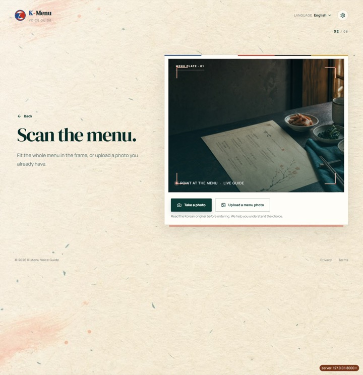
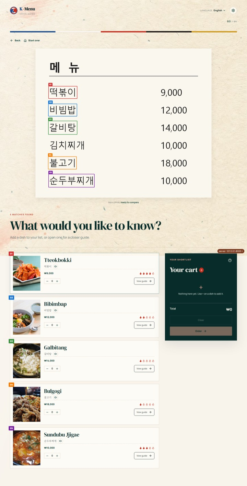
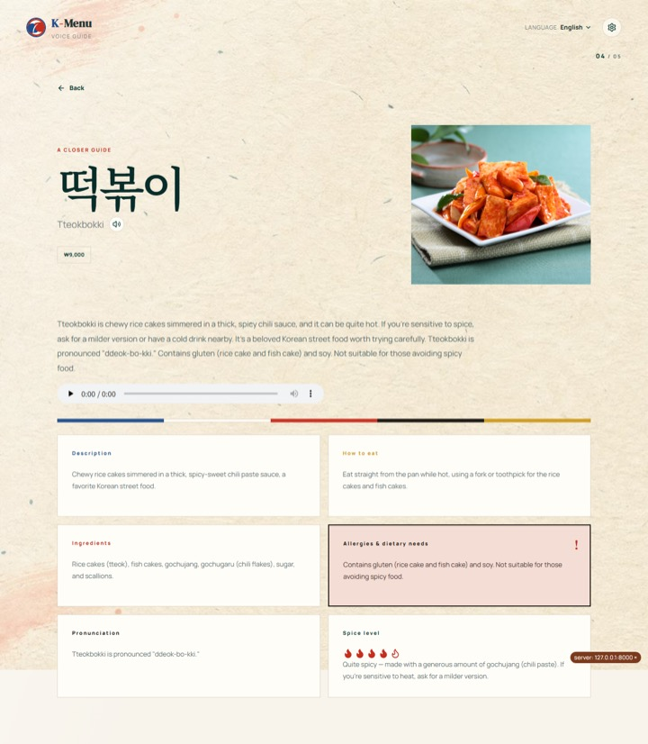
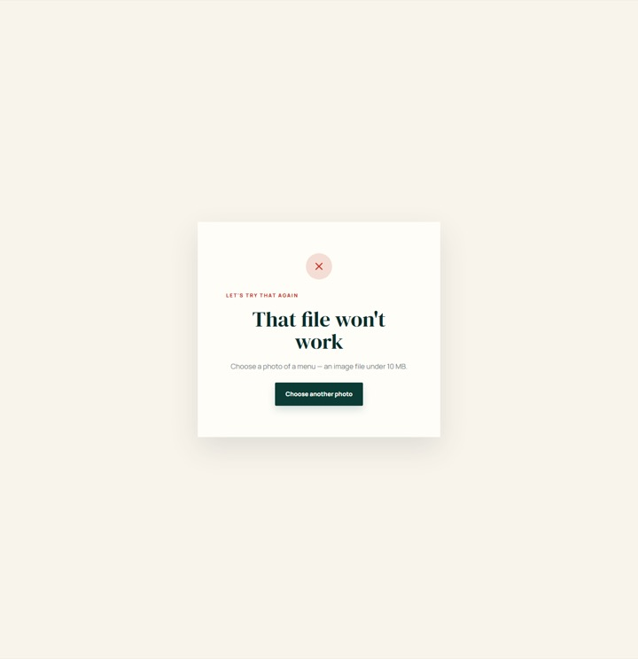
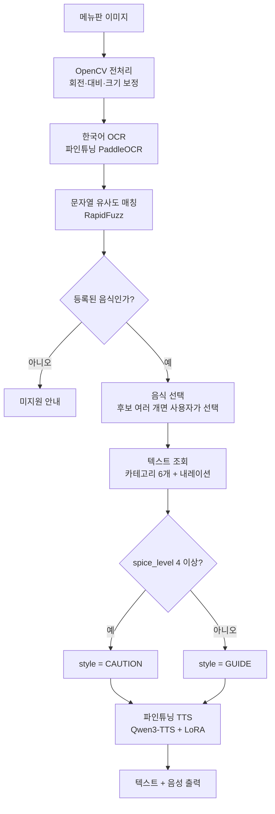
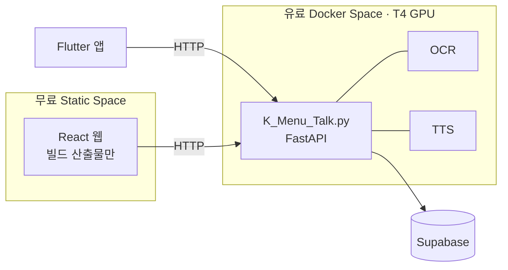

# K-Menu Voice Guide

**영어권 관광객이 한국어 메뉴판을 촬영하면, 음식의 발음·맵기·재료·먹는 법·알레르기까지
영어 텍스트와 음성으로 설명해주는 멀티모달 한국 음식 가이드.**

| | 주소 | 지금 살아있는지 |
|---|---|---|
| 웹 | <https://hju5022-k-menu-react.static.hf.space> | 화면이 뜨면 정상 |
| API | <https://hju5022-k-menu.hf.space/api/foods> | 음식 50개가 JSON으로 나오면 정상 |
| 저장소 | <https://github.com/aihuman-7th/proj1-c> | `main`이 최종본 |

```bash
curl -s -o /dev/null -w "web %{http_code}\n" https://hju5022-k-menu-react.static.hf.space
curl -s -o /dev/null -w "api %{http_code}\n" https://hju5022-k-menu.hf.space/api/foods
```

둘 다 `200`(웹은 `302`도 정상)이면 서비스 전체가 살아 있다. API가 `503`과 함께
`The space is paused`를 돌려주면 **GPU Space가 일시정지된 상태**다 — 유료 T4 Space라 쓰지 않을 때
멈춰두며, 관리자가 Space를 다시 시작해야 한다. 웹은 무료 Static Space라 항상 떠 있지만,
API가 멈춰 있으면 화면만 보이고 분석·음성은 동작하지 않는다.

> KDT AI Human 7기 1차 프로젝트 · 팀 C · 개발 기간 14일
> 왜 만들었고 무엇을 달성했는가(근거·실측·한계)는 [`docs/기획서.md`](docs/기획서.md)에 있다.

---

## 1. 문제 정의

> **한국 음식에 익숙하지 않은 영어권 개별 관광객은, 번역 앱이 글자만 옮기는 방식이라
> 음식이 무엇인지 알 수 없는 불편을 겪고 있으므로, 메뉴판 사진 한 장에서 음식을 알아보고
> 맛·재료·먹는 법·맵기를 영어 음성으로 설명해주는 서비스가 필요하다.**

```
곱창전골 → Beef intestine hot pot
```

번역은 됐지만 맛·조리 방식·먹는 방법·매운 정도는 여전히 알 수 없다. 방한 외국인 관광객은
2023년 1,103만 명에서 2025년 1,893만 명으로 늘었고 음식점 소비 중 한식 비중이 80.6%로 가장
높다(제주관광공사·신한카드 빅데이터, 2023). 대상 사용자·고객 여정·경쟁 서비스 비교는
[`docs/기획서.md` 1장](docs/기획서.md#1-문제-정의).

---

## 2. 데모

메뉴판 사진 한 장(왼쪽)을 올리면 후보를 찾아 설명과 음성까지 이어진다.
아래는 실제로 돌린 화면을 찍은 것이다(2026-08-26, 로컬 CPU 환경).

| 촬영·업로드 | 후보 목록 |
|---|---|
|  |  |
| 촬영과 갤러리 업로드를 둘 다 받는다 | 메뉴판 위에 인식 위치를 번호로 겹쳐 보여준다 |

| 음식 상세 | 오류 안내 |
|---|---|
|  |  |
| 카테고리 6개 + 내레이션 음성. 알레르기 카드만 붉게 강조된다 | 이미지가 아닌 파일은 400으로 구분해 안내한다 |

후보 화면에서 6줄 중 5개가 매칭됐고 `김치찌개` 한 줄은 빠져 있다. OCR이 `召大|`로 잘못 읽어
매칭에 실패한 실제 사례다 — **추측해서 채우지 않고 조용히 뺀다.**

### 음성 샘플

음성 서비스라 화면만으로는 절반만 전해진다. 아래는 현재 배포 중인 모델이 만든 파일이다
(2026-08-27 생성, 한글 표기 입력 기준).

| 파일 | 무엇 |
|---|---|
| [`food_1_GUIDE.wav`](docs/assets/audio/food_1_GUIDE.wav) | 비빔밥(spice_level 2) 내레이션 — **GUIDE** 톤 |
| [`food_3_CAUTION.wav`](docs/assets/audio/food_3_CAUTION.wav) | 떡볶이(spice_level 4) 내레이션 — **CAUTION** 톤 |
| [`name_1.wav`](docs/assets/audio/name_1.wav) | 음식 이름만 읽는 음성 (비빔밥) |
| [`name_3.wav`](docs/assets/audio/name_3.wav) | 음식 이름만 읽는 음성 (떡볶이) |

같은 파이프라인에 **음식 데이터만 다르게** 넣은 결과다. 사용자가 톤을 고르지 않는다 —
`spice_level`이 4 이상이면 자동으로 CAUTION이 된다. 입력 이미지는
[`sample-menu-synthetic.jpg`](docs/assets/sample-menu-synthetic.jpg)(저작권 문제를 피하려고 직접 만든 합성 메뉴판).

---

## 3. 핵심 기능

- **메뉴판 사진 한 장에서 음식을 찾아낸다** — 파인튜닝 OCR로 한글을 읽고 유사도 매칭으로 등록
  음식 50개와 맞춘다. 글자를 조금 틀려도 찾아낸다(실측 매칭 재현율 **91.67%**).
- **음식마다 영어 설명 6종** — 발음 · 맵기 · 설명 · 재료 · 먹는 법 · 알레르기/채식.
  LLM이 지어내지 않고 팀이 미리 작성해 DB에 넣은 문장을 조회한다.
- **맵기가 음성의 톤을 자동으로 바꾼다** — `spice_level` 1~3은 차분한 GUIDE, 4~5는 주의를 주는
  CAUTION. 사용자가 고르는 값이 아니라 음식 데이터가 정한다.
- **한국어 발음 그대로 읽어주는 이름 음성** — 직원에게 "뭘 달라"고 말할 수 있게, 로마자를 영어식으로
  읽지 않고 한국어 발음으로 들려준다.
- **장바구니와 주문 요약** — 담은 것을 화면에 정리해 직원에게 그대로 보여준다.
  웹(React)과 모바일 앱(Flutter) 두 클라이언트가 같은 API를 쓴다.

등록되지 않은 음식은 **설명하지 않고 미지원으로 안내한다.** 범위 밖 항목은
[`docs/기획서.md` 3장](docs/기획서.md#3-범위).

---

## 4. 파이프라인과 배포 구조



| 단계 | 모듈 | 입력 | 출력 |
|---|---|---|---|
| 1 | `src/ocr/` | 메뉴판 이미지 | 음식 후보 목록 |
| 2 | `src/text_gen/` | 선택된 음식 | 상세 텍스트 6개 + 내레이션 텍스트 1개 |
| 3 | `src/tts/` | 내레이션 텍스트 + 스타일 | WAV 음성 |

계산은 GPU Space 한 곳에 몰고, 화면은 무료 Static Space에 둔다. 웹에도 계산을 두면 GPU 비용이
두 배가 되기 때문이다.



---

## 5. 모델·기술 스택과 실험 결과

### 스택

| 층 | 무엇을 썼나 |
|---|---|
| OCR | PaddleOCR `korean_PP-OCRv5_mobile_rec`를 **파인튜닝** → [`k-bite-team/K_Bite_OCR`](https://huggingface.co/k-bite-team/K_Bite_OCR) · 전처리는 OpenCV |
| 음식명 매칭 | RapidFuzz 문자열 유사도 (등록 음식 50개 대상) |
| TTS | `Qwen/Qwen3-TTS-12Hz-1.7B-Base` + **LoRA(PEFT) 파인튜닝** → [`k-bite-team/k-menu-qwen3-tts-lora`](https://huggingface.co/k-bite-team/k-menu-qwen3-tts-lora) |
| 설명 텍스트 | 팀이 작성해 Supabase에 넣은 문장을 조회·조합 — **런타임에 외부 LLM을 쓰지 않는다** |
| 서버 | FastAPI (`K_Menu_Talk.py`, 엔드포인트 6개) |
| 클라이언트 | React + TypeScript + Vite (`frontend/`) · Flutter (`mobile/`) |
| 배포 | Hugging Face Spaces — Docker(T4 GPU) + Static |

배포 중인 TTS 체크포인트는 **9차** `instruct_trained_lr5e-6_ep40 / checkpoint-epoch-31`
(lr 5e-6 · rank 16 · alpha 32 · 40 epoch), `LORA_SCALE` 0.15다.

### 비교 실험 결과

**TTS — LoRA 하이퍼파라미터 6회 탐색** (낮을수록 좋음, 원본 `eval/training_log.csv`)

| 회차 | 바꾼 것 | 최종 Val Loss |
|---|---|---|
| 3차 `lr5e-6_ep40` | 기준 | **8.913** |
| 4차 `lr1e-5_ep40` | LR 2배 | 9.549 |
| 5차 `lr2e-5_ep40` | LR 4배 (공식 기본값) | 10.273 |
| 6차 `lr5e-6_r32_ep40` | LoRA rank 32 | 9.186 |
| 7차 `lr5e-6_ep100` | 100 epoch | 10.389 |
| 8차 `final_respelled` | 리스펠링 21개 반영 | **8.912** |

**공식 기본 학습률(2e-5)이 우리 데이터에서 가장 나빴다.** 단일 화자·소량 데이터라 큰 학습률이
어댑터를 흔든 것으로 본다.

**TTS 품질 — 상용 서비스(Perso.ai)와 같은 문장·같은 화자로 비교** (UTMOS22 자동 채점)

| 스타일 | 우리 모델 | Perso.ai | 상대 점수 |
|---|---|---|---|
| GUIDE | 4.29 | 4.11 | **104.3%** |
| CAUTION | 4.44 | 4.16 | **106.9%** |

> ⚠️ 표본이 스타일당 1문장(n=1)이라 통계적 유의성은 없다. **"이겼다"고 단정하지 않는다.**
> 사람 MOS 정식 평가는 미실시다. 남은 과제는 [`docs/기획서.md` 9장](docs/기획서.md#9-한계와-남은-과제)에 그대로 적어두었다.

**OCR — 파인튜닝 전후 비교** (실제 메뉴판 사진 50장, 2026-08-28 같은 코드·같은 박스로 측정.
원본 `eval/measure_ocr_base.json` · `eval/measure_ocr_final.json`)

| 인식기 | 매칭 재현율 | 라벨 완전일치 | 라벨 CER |
|---|---|---|---|
| base — PaddleOCR 기본 인식기 (`PP-OCRv6_medium_rec`) | **0.0%** (0/36) | 0.0% | 0.982 |
| **파인튜닝 (실제 배포)** | **91.67%** (33/36) | 72.3% | 0.218 |

기본 인식기는 한글을 아예 다른 글자로 읽는다 — `泡菜包猪肉`, `腌辣牡蛎`처럼 한자·영문으로 나와
음식명이 하나도 안 걸린다. `lang="korean"`을 줘도 인식 모델은 범용 `PP-OCRv6_medium_rec`가 잡히기
때문이다. **한국어 메뉴판에는 기성 OCR을 그대로 쓸 수 없다는 것이 이 0%의 의미다.**

난이도별로 나눠 보면 이렇다.

| 카테고리 | 장수 | 매칭 대상 | base 재현율 | 파인튜닝 재현율 |
|---|---|---|---|---|
| 01_normal | 20 | 20 | 0.0% | 90.0% |
| 02_multi_food | 15 | 15 | 0.0% | 93.3% |
| 03_low_quality | 10 | 1 | 0.0% | 100.0%* |
| 04_unregistered | 5 | 0 | — | — |
| **전체** | **50** | **36** | **0.0%** | **91.67%** |

\* 저화질 10장은 찍힌 음식이 대부분 지원 목록 밖이라 매칭 대상이 1장뿐이다. 표본이 작다.

**라벨 완전일치(72.3%)보다 매칭 재현율(91.67%)이 높다.** OCR이 글자를 틀려도 유사도 매칭이
정답을 찾아내기 때문이며, 목표를 OCR 단독이 아니라 **OCR + 매칭의 합**으로 잡은 이유다.

**파인튜닝의 대가 — 숫자 인식이 무너졌고, 하이브리드로 되돌렸다** (`eval/measure_digits.json`)

| 인식기 | 가격 숫자 완전일치 | 숫자 CER |
|---|---|---|
| base (PaddleOCR 기본) | 77.78% | 3.44% |
| 파인튜닝 체크포인트 | **5.56%** | **37.18%** |
| **production (실제 배포 경로)** | **77.78%** | **3.44%** |

등록 음식 50개 글자만 모은 커스텀 딕셔너리로 학습해 숫자를 읽는 능력이 사라졌다
(catastrophic forgetting). `src/ocr/infer.py`가 **한글이 없는 조각은 base 결과를 채택**하는
하이브리드로 배포 경로 수치를 base와 같게 되돌렸다.

**응답 속도 — 실시간 생성을 포기하고 사전 생성 캐시로 바꾼 근거**

| 항목 | 값 |
|---|---|
| TTFB 목표 | 5~7초 |
| 라이브 생성 실측 | 33초 (콜드 61.3초) · RTF 1.47 |
| 사전 생성 캐시 실측 | **1.8ms** (n=50) |
| OCR 92상자 처리 | CPU 22.8초 → **GPU 0.8초** |

배포된 서버(T4 Space)에서 직접 잰 값은 아래와 같다(2026-08-28, 네트워크 왕복 포함).

| 요청 | Space 기동 직후 첫 요청 | 그 다음부터 |
|---|---|---|
| `GET /api/foods` | 19.4초 | 0.81~0.84초 |
| `POST /api/analyze` (사진 1장, OCR 전체) | 11.3초 | **1.26~1.33초** |
| `GET /api/foods/{id}` (상세 + 음성 준비) | — | 0.81~0.83초 (서버 내부 TTS 0.6ms) |

웜 상태 0.8초는 대부분 네트워크 왕복이다. 첫 요청이 느린 것은 컨테이너 기동과 모델 적재 때문이며,
**Space가 일시정지 상태에서 깨어난 직후 한 번만** 나타난다.

측정 과정과 판단 근거 전문은 [`eval/model_comparison.md`](eval/model_comparison.md)와
[`eval/TTS_MODULE.md`](eval/TTS_MODULE.md), 요약은
[`docs/기획서.md` 5~6장](docs/기획서.md#5-모델-선택-근거).

---

## 6. 실행 방법

### 준비물

- Python 3.11
- Node.js + [pnpm](https://pnpm.io) (웹 화면을 볼 때만)
- Flutter SDK (모바일 앱을 볼 때만)
- GPU는 **없어도 된다.** OCR은 CPU에서도 돌고(느릴 뿐), TTS는 사전 생성 캐시를 읽는다.

### 1. 파이썬 환경

```bash
python -m venv .venv
source .venv/bin/activate        # Windows: .venv\Scripts\activate
pip install -r requirements.txt
```

### 2. TTS는 별도 환경에 깐다

`paddle`(OCR)과 `torch`(TTS)를 한 프로세스에 함께 올릴 수 없어서, TTS는 자식 프로세스로
분리해 돌린다(`src/tts/worker.py`). 그 자식이 쓸 환경을 따로 만든다.

```bash
python -m venv .venv-tts
.venv-tts/bin/pip install "torch==2.6.0" "torchaudio==2.6.0" qwen-tts peft transformers safetensors soundfile huggingface_hub numpy
```

`torch`와 `torchaudio`는 **버전을 못 박아야 한다.** 둘은 같은 버전끼리만 맞물리는데, 버전을
안 적으면 그날의 최신을 각각 집어와 짝이 깨진다. 실제로 어긋났을 때 `qwen_tts` 임포트가
`OSError: [WinError 127]`로 죽어 TTS가 통째로 멈췄다. 로딩 실패라 **캐시가 있으면 증상이
안 보인다** — 라이브 생성만 조용히 죽는다.

### 3. 환경변수

`.env.example`을 `.env`로 복사한 뒤 값을 채운다. 필요한 키의 설명은 그 파일 안에 다 적혀 있다.

```bash
cp .env.example .env
```

macOS·Linux에서는 **`TTS_VENV_PYTHON`을 반드시 채워야 한다.** 기본값이 Windows 구조
(`.venv-tts/Scripts/python.exe`)라, 비워두면 위에서 만든 환경을 못 찾는다.

```env
TTS_VENV_PYTHON=.venv-tts/bin/python
```

### 4. API 서버 띄우기

```bash
uvicorn K_Menu_Talk:app --host 0.0.0.0 --port 8000
```

`--host 0.0.0.0`은 실제 휴대폰에서 붙을 때 필요하다. 기본값(`127.0.0.1`)이면 이 컴퓨터
자신만 접속할 수 있다.

```bash
curl http://localhost:8000/api/foods
```

지원 음식 50개가 JSON으로 나오면 DB 연결까지 정상이다. 서버 기동 후 **첫 요청**만
Supabase를 한 번에 읽느라 2.5초쯤 걸리고, 그 뒤로는 메모리 캐시라 사라진다.

엔드포인트는 6개다. 요청·응답 계약은 [`docs/specs/api-layer.md`](docs/specs/api-layer.md)가 정본이다.

| 메서드 | 경로 | 하는 일 |
|---|---|---|
| `POST` | `/api/analyze` | 메뉴판 사진 ──▶ 음식 후보 목록 |
| `GET` | `/api/foods` | 안내 가능한 음식 50개 목록 |
| `GET` | `/api/foods/{food_id}` | 상세 텍스트 6개 + 내레이션 텍스트·음성 |
| `GET` | `/api/cart` | 장바구니 조회 |
| `POST` | `/api/cart/items` | 담기·수량 조절 |
| `DELETE` | `/api/cart` | 비우기 |

### 5. 음성 캐시 만들기

캐시는 git에 올라가지 않으므로 **새 컴퓨터에서는 비어 있다.** 채우지 않으면 요청마다
라이브 생성으로 넘어간다.

```bash
python -m src.tts.pregenerate
```

음식 50개의 나레이션 음성과 이름 음성을 미리 만들어 `static/tts_cache/`에 넣는다.
나레이션 문장이 바뀐 뒤라면 `--force`를 붙여 다시 만들어야 한다 — 파일이 이미 있으면
건너뛰기 때문이다.

### 6. 웹 화면

```bash
cd frontend
pnpm install
pnpm run dev
```

`frontend/.env`에 백엔드 주소를 넣는다. `VITE_` 값은 브라우저에 그대로 실리므로 토큰·비밀번호를
넣지 않는다.

```env
VITE_API_BASE_URL=http://localhost:8000
```

### 7. 모바일 앱

```bash
cd mobile
flutter run
```

서버 주소는 `mobile/lib/config.dart` 한 곳에서 바꾼다(기본값은 배포 서버). 시뮬레이터·에뮬레이터는
`http://localhost:8000`, 실제 휴대폰은 `http://<이 컴퓨터의 LAN IP>:8000`이다 — 폰에게
`localhost`는 폰 자신이라 서버를 못 찾는다. 자세한 것은 [`mobile/README.md`](mobile/README.md).

### 테스트

```bash
python -m pytest
```

테스트 245개가 몇 초 만에 돈다. OCR·TTS 모델도 Supabase도 부르지 않는다. `unittest.mock`으로
가짜 값을 끼워넣어 **로직과 연결 방식만** 검사하므로 GPU 없이, 인터넷 없이 실행된다. 무엇을 왜
검사하는지는 [`tests/README.md`](tests/README.md).

모델 성능은 테스트가 아니라 `eval/`에서 잰다. 실제 사진과 GPU가 필요한 것과 없이도 되는 것이
갈리므로 [`eval/README.md`](eval/README.md)를 먼저 볼 것.

### 배포

| | Space | 무엇이 올라가나 |
|---|---|---|
| API | `HJU5022/K_Menu` (Docker, T4 GPU) | 저장소 전체 |
| 웹 | `HJU5022/K_Menu_react` (Static, 무료) | `pnpm run build` 결과물만 |

```bash
deploy/api-space/deploy.sh                                  # main을 API Space에
frontend/space/deploy.sh HJU5022/K_Menu_react               # 웹 빌드 결과물을 Static Space에
```

두 스크립트 모두 **대상 Space를 통째로 덮어쓴다(`--force`).** 소스는 GitHub에 있고 Space에는
산출물만 두므로, 되돌릴 일이 생기면 그 시점 소스를 다시 올리면 된다.

웹은 서버 주소가 **빌드 시점에 JS 안에 박힌다**(Vite의 `VITE_` 규칙). 그래서 주소를 바꾸려면
다시 빌드해야 한다 — Space에 환경변수를 넣는 것으로는 바뀌지 않는다. 절차와 제약은
[`docs/specs/fastapi-space-deploy.md`](docs/specs/fastapi-space-deploy.md)와
[`frontend/docs/deployment.md`](frontend/docs/deployment.md).

---

## 7. 저장소 구조

폴더가 무슨 일을 하는지만 적는다. **파일 단위 설명은 각 폴더의 README에 있다** — 같은 내용을
두 군데 적으면 한쪽만 고쳤을 때 조용히 갈라지기 때문이다.

```
proj1-c/
├── K_Menu_Talk.py        API 진입점 (FastAPI). 화면을 갖지 않고 엔드포인트 6개만 노출한다
├── Dockerfile            API를 올리는 GPU Docker Space용 이미지
├── requirements.txt      API·OCR·TTS가 쓰는 파이썬 패키지
│
├── src/                  실제 로직 → src/README.md
│   ├── ocr/                이미지 ──▶ 음식 후보 목록
│   ├── text_gen/           음식 ──▶ 상세 텍스트 6개 + 내레이션 텍스트 1개
│   ├── db/                 Supabase 읽기 전용 접근 + 메모리 캐시
│   ├── tts/                내레이션 텍스트 + 스타일 ──▶ WAV
│   ├── cart/               장바구니 (파이프라인 단계가 아니라 별도 상태 저장소)
│   └── pipeline.py         위 블록들을 입출력 계약대로 연결
│
├── frontend/             React + TypeScript 웹 화면 → frontend/README.md
├── mobile/               Flutter 모바일 앱 (iOS·Android) → mobile/README.md
│
├── tests/                pytest — 모델·DB를 부르지 않고 로직만 검사 → tests/README.md
├── eval/                 모델 성능 측정과 그 원본 기록 → eval/README.md
├── docs/                 기획서 · Spec · 문구 기준 · 화면 캡처 → docs/README.md
├── deploy/api-space/     API Space 배포 스크립트와 Space 설정
├── data/                 데이터 받는 법·변환법만 (파일 자체는 git 제외) → data/README.md
└── models/               HF Hub 모델 ID 기록 → models/README.md
```

git에 따라오지 않지만 실행하면 생기는 폴더가 셋 있다.

| 폴더 | 무엇 | 없으면 |
|---|---|---|
| `static/tts_cache/` | 사전 생성 음성 100개 (나레이션 50 + 이름 50) | 요청마다 라이브 생성으로 넘어가 음식당 수십 초가 걸린다 |
| `static/audio/` | 라이브 생성한 wav — `/audio/{파일명}`으로 서빙 | 서버가 알아서 만든다 |
| `logs/` | `tts_worker.log` 등 실행 로그 | 서버가 알아서 만든다 |

---

## 8. 팀

| 이름 | GitHub | 역할 |
|---|---|---|
| 하정운(조장) | [@HJU5022](https://github.com/HJU5022) | PM · OCR 파인튜닝 · 파이프라인 통합 · DB · 배포 |
| 박민영 | [@pastar20250101-creator](https://github.com/pastar20250101-creator) | TTS 파인튜닝 · 하이퍼파라미터 실험 · UX/UI |
| 배재훈 | [@Bae-JaeHun](https://github.com/Bae-JaeHun) | 데이터 구축 (프로젝트 참여 종료) |
| 차백호 | [@cosohotmas](https://github.com/cosohotmas) | TTS 추론 |

---

## 9. 라이선스·윤리 고지

### 모델

| 무엇 | 라이선스 |
|---|---|
| `Qwen/Qwen3-TTS-12Hz-1.7B-Base` (TTS 베이스) | Apache-2.0 |
| `k-bite-team/k-menu-qwen3-tts-lora` (우리 LoRA 어댑터) | Apache-2.0 |
| PaddleOCR `korean_PP-OCRv5_mobile_rec` (OCR 베이스) | Apache-2.0 |
| `src/ocr/vendor/ppocr/` (PaddleOCR 저장소 코드 일부를 그대로 사용) | Apache-2.0 |
| `k-bite-team/K_Bite_OCR` (우리 OCR 체크포인트) | 별도 라이선스 미표기 — 베이스 모델의 Apache-2.0을 따른다 |

### 음성 데이터

TTS 학습·평가에 쓴 음성은 **팀원 본인이 직접 녹음하고 서면 동의한 것**이다. 공개 저장소에는
이름·연락처·서명 이미지를 가린 공개본만 두고, 서명 원본은 팀 내부에 따로 보관한다
([`docs/legal/tts-voice-consent/`](docs/legal/tts-voice-consent/)). 상용 서비스(Perso.ai)와의
비교도 **같은 화자의 동의 범위 안에서** 클로닝해 조건을 맞췄다.

### 학습 데이터·이미지

- OCR 학습·검증 데이터는 **AI Hub '관광 음식메뉴판 데이터'**를 신청·승인받아 사용했다.
  데이터 파일 자체는 저장소에 올리지 않는다(`data/README.md`에 받는 법만 적어둔다).
- 문서와 데모에 쓰는 메뉴판 이미지는 실제 식당 메뉴판을 베끼지 않고 **직접 만든 합성 이미지**다.
- 음식 사진을 화면에 띄울 때는 `thumbnail_attribution`(출처 문구)을 **반드시 함께 표시한다.**
  사진만 나오고 출처가 빠지는 경우가 없도록 웹·앱 스펙의 AC로 못 박았다.

### 안전

- **런타임에 외부 LLM을 쓰지 않는다.** 알레르기·재료 설명은 팀이 미리 작성해 DB에 넣은 문장만
  조회한다 — 환각이 나오면 그대로 안전 문제가 되기 때문이다.
- 알레르기 정보는 **참고용**임을 화면에 명시한다.
- 등록되지 않은 음식은 추측해서 설명하지 않고 미지원으로 안내한다.
- 업로드한 사진은 저장하지 않으며, 그 사실을 첫 화면에 적어둔다.

---

## 문서 지도

| 무엇이 궁금한가 | 어디를 보나 |
|---|---|
| 왜 만들었나, 목표를 달성했나, 무엇이 한계인가 | [`docs/기획서.md`](docs/기획서.md) |
| 기능별 Spec (API·OCR·TTS·장바구니·배포) | [`docs/README.md`](docs/README.md) |
| 웹 화면 흐름·화면별 스펙 | [`frontend/docs/README.md`](frontend/docs/README.md) |
| 화면에 쓰는 영어 문구 기준 (웹·앱 공통) | [`docs/content-style.md`](docs/content-style.md) |
| 모델을 왜 이걸 골랐나, 실측 원본 | [`eval/README.md`](eval/README.md) |
| 에이전트·기여 규칙 (브랜치·PR·보안) | [`AGENTS.md`](AGENTS.md) |

## 기여 규칙 요약

- `main`에 직접 커밋·push하지 않는다. `feat/{내용}`·`fix/{내용}`·`docs/{내용}` 브랜치를 만들고 PR로만 합친다.
- 기능을 만들기 전에 `docs/specs/{기능명}.md`를 먼저 쓴다.
- API 키·토큰을 코드에 넣지 않는다. `.env`로만 불러오고, `.env.example`에는 키 이름만 적는다.
- AC 테스트가 통과하기 전에는 "완료"라고 하지 않는다.

전문은 [`AGENTS.md`](AGENTS.md)에 있다.
