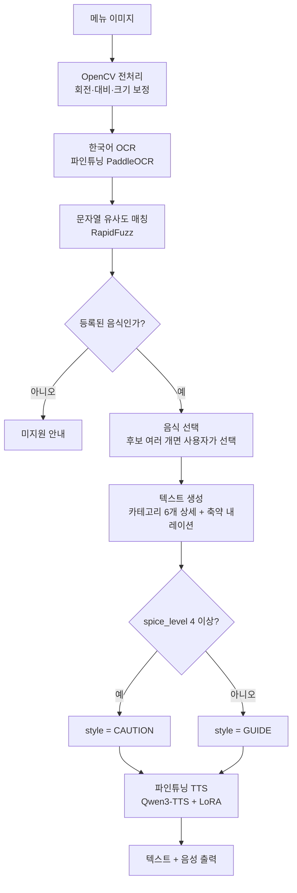

# K-MENU VOICE GUIDE

*영어권 관광객을 위한 한국 음식 멀티모달 음성 가이드*

**MVP 기획서 v3**

| 항목 | 내용 |
|---|---|
| 프로젝트 | KDT AI Human 7기 1차 프로젝트 · 나만의 음성모델 만들기 |
| 팀 구성 | 팀 C (4명) — 아래 팀원 소개 참고 |
| 개발 기간 | 14일 |
| 가용 자원 | 노트북 RTX 5060 1대 · 원격 데스크톱 RTX 3080 Ti 12GB · 필요 시 Colab |
| 주제 유형 | 유형 2 · 입력 조건에 따른 조건부 TTS |

> 본 문서는 GitHub 공개용으로 정리된 버전이다(v3). 내부 검토 로그, 실험 경과, 상세 하이퍼파라미터 등은 팀 내부 문서에서 별도로 관리한다.

### 팀원 소개

| 이름 | GitHub | 역할 | 비고 |
|---|---|---|---|
| 하정운(조장) | @HJU5022 | PM·OCR 파인튜닝·파이프라인 통합·DB·배포 | |
| 박민영 | @pastar20250101-creator | TTS 파인튜닝·하이퍼파라미터 실험·UX/UI | |
| 배재훈 | @Bae-JaeHun | 데이터 구축 | 프로젝트 참여 종료 |
| 차백호 | @cosohotmas | TTS 추론 | |

---

## 1. 프로젝트 소개

영어권 외국인 관광객이 한국어 메뉴판을 촬영하면, 음식의 특징·재료·맛·맵기·먹는 법·알레르기 정보까지 이해하기 쉬운 영어 텍스트와 음성으로 자동 설명해주는 멀티모달 한국 음식 가이드. 기존 번역 서비스가 '글자를 옮기는 것'에 그치는 것과 달리, 사진 한 장만으로 재료·맛·맵기·먹는 법까지 실용적으로 전달하는 것이 차별점이다.

- 프로젝트 유형: 유형 2 — 입력 조건(음식의 매운 정도)에 따른 TTS 음성 변화
- 핵심 학습 대상: 딥러닝 TTS 모델 + Vision/OCR 모델 (둘 다 파인튜닝 대상)

---

## 2. 문제 정의

한국 음식에 익숙하지 않은 영어권 개별 관광객은 한국어 메뉴판을 번역하더라도 음식의 재료·맛·맵기·먹는 방법을 충분히 이해하기 어려워 메뉴 선택에 불편을 겪으므로, 메뉴를 촬영하면 필요한 음식 정보를 이해하기 쉬운 텍스트와 음성으로 자동 설명해주는 서비스가 필요하다.

> 곱창전골 → Beef intestine hot pot
> 번역은 되었지만 맛·조리 방식·먹는 방법은 여전히 알기 어렵다.

**근거**: 방한 외국인 관광객은 2023년 1,103만 명에서 2025년 1,893만 명으로 증가했고, 음식점 소비 중 한식 비중이 80.6%로 가장 높다(제주관광공사·신한카드 빅데이터, 2023). 여행 블로거·현지 리뷰 등 1차 자료에서도 한글 메뉴판을 이해하지 못해 주문에 실패한 사례가 확인된다(예: [Jaclynn Seah, "My Seoul Food Experience," 2024](https://theoccasionaltraveller.com/seoul-food/)).

### 왜 번역 앱만으로는 부족한가

| 서비스 | 분류 | 한계 |
|---|---|---|
| 캐치테이블 영어버전 | 예약 앱 + 메뉴/매장 번역 | 예약이 핵심 기능, 재료·맵기 등 음식 정보 응답 기능 없음 |
| 네이버 파파고 | 번역 앱 (TTS 포함) | 텍스트/음성 번역은 되지만 재료·맛·맵기·먹는 법 등 실용 정보는 제공하지 않음 |
| '맛말' (글나무) | QR코드 기반 외국어 메뉴판 | 맵기 단계·재료·알레르기 정보를 텍스트로 제공하나 음성 설명 없음 |

결론: 기존 서비스들은 '번역'과 '일부 음성 낭독'에 그치며, 재료·맛·맵기·먹는 법·알레르기 정보를 음성과 텍스트로 함께 설명하는 서비스는 확인되지 않았다. 이것이 이 프로젝트의 핵심 차별점이다.

---

## 3. MVP 기능 범위

- 지원 언어: 영어 1개
- 지원 음식: 한국 대표 음식50개
- 설명 카테고리: 발음·맵기·설명·재료·먹는 법·알레르기/채식 6개 — 음식이 인식되면 6개 전부 자동 제공
- TTS 스타일: GUIDE·CAUTION 2개, 음식의 맵기 단계(spice_level) 기준 자동 결정
- 맵기 표시: 불꽃 아이콘 5개 채움 + 참고 스코빌 수치
- 입력 방식: 메뉴 사진 촬영(Vision/OCR)만 지원, 별도 음성 질문(STT) 없음
- 배포 형태: Flutter 앱 (최종 목표). 웹은 Streamlit(`app.py`) 하나로 간다 — React 웹앱은 2026-08-23에 제거했다

### 카테고리 구성

| 번호 | 카테고리 | 설명 |
|---|---|---|
| 1 | 발음 | 정확한 이름과 발음 |
| 2 | 맵기 | 매운 단계 |
| 3 | 설명 | 어떤 음식인지 |
| 4 | 재료 | 무엇으로 만들었는지 |
| 5 | 먹는 법 | 어떻게 먹는지 |
| 6 | 알레르기/채식 | 알레르기 유발 성분·채식 여부 |

### 맵기 척도

| 단계 | 비유 기준 | 참고 수치 |
|---|---|---|
| 1 (순함) | Bell Pepper-level | 0 SHU |
| 2 (약간 매움) | Poblano-level | 약 1,000~2,000 SHU |
| 3 (보통) | Jalapeño-level | 약 2,500~8,000 SHU |
| 4 (매움) | Cheongyang Chili-level | 약 4,000~12,000 SHU |
| 5 (아주 매움) | Buldak Bokkeummyeon-level | 4,404 SHU |

### Out of Scope (이번 MVP)

- 등록되지 않은 모든 한국 음식 설명
- 실시간 동영상 OCR·손글씨 메뉴 완벽 인식
- 식당 주문·결제·예약, 직원과의 실시간 통역
- 사용자 음식 등록 기능
- 영어 이외 다국어 지원, 자유로운 AI 대화(외부 LLM API)

---

## 4. 시스템 아키텍처

### 파이프라인



### 정상 흐름

1. 사용자가 메뉴판을 촬영하거나 사진을 업로드한다.
2. Vision/OCR(파인튜닝)이 메뉴판의 한국어 글자를 추출한다.
3. 등록된 50개 음식명과 OCR 결과를 문자열 유사도(RapidFuzz)로 비교한다.
4. 인식된 음식 목록을 보여주고 사용자가 하나를 선택한다.
5. 선택된 음식을 기준으로 카테고리별 상세 텍스트(6개)와 축약 내레이션 텍스트를 만든다.
6. 음식의 맵기 단계(spice_level)를 기준으로 GUIDE 또는 CAUTION 스타일을 자동 결정한다.
7. 파인튜닝 TTS가 축약 내레이션 음성을 생성한다.
8. 카테고리별 상세 텍스트(화면)와 축약 내레이션 음성을 함께 출력한다.

### 예외 상황

| 상황 | 처리 |
|---|---|
| OCR 결과 없음 | 조명·거리·각도 안내 후 재촬영 요청 |
| 여러 음식 인식 | 번호+카드 UI로 목록을 보여주고 하나를 선택 |
| 등록되지 않은 음식 | 미지원 안내 |
| TTS 생성 실패 | 상세 텍스트 우선 출력 + 재생 버튼 제공 |
| GPU/DB 연결 실패 | 오류 메시지 + 재시도 버튼 |

### 데이터 소스

AI Hub '관광 음식메뉴판 데이터'(이미지 100,113장, 한식 28.1%)를 OCR 테스트·학습 양쪽에 활용한다. 맛·먹는 법·알레르기 같은 서술형 설명은 팀이 직접 조사해 보완한다.

### Vision/OCR

- OpenCV로 회전·대비·크기 보정
- PaddleOCR을 커스텀 딕셔너리 방식으로 파인튜닝
- RapidFuzz로 OCR 결과와 등록 음식명 유사도 비교
- 메뉴 사진 50장 이상으로 인식 성능 평가

### 텍스트생성

외부 LLM API를 사용하지 않고, 팀이 미리 작성해 Supabase에 저장해 둔 텍스트를 조회하는 방식이다(자유 생성 아님).

- 상세 텍스트(화면용): `food_details` 테이블에서 6개 카테고리 텍스트를 조회
- 축약 내레이션(음성용): spice_level로 결정된 style(GUIDE/CAUTION)에 해당하는 `food_narration` 텍스트에, `food_details`의 PRONUNCIATION·ALLERGY 문장을 이어붙여 만든다 — 셋 다 미리 작성된 문장이라 그대로 조회해서 이어붙일 뿐, 새로 생성하지 않는다 (`docs/specs/text-generation.md` 참고)

### 음식 DB (Supabase)

`foods` 테이블 (음식 50개)

| 열 | 설명 |
|---|---|
| id | 기본키 |
| name_kr / name_en | 한글명 / 영문·로마자명 |
| spice_level | 맵기 단계(1~5) |
| thumbnail_url | 대표 사진 링크 |

`food_details` 테이블 (음식 × 카테고리, 최대 180행): `food_id`, `category`, `detail_text`

카테고리는 화면용 6개(PRONUNCIATION·SPICY·DESCRIPTION·INGREDIENT·HOW_TO_EAT·ALLERGY)에 음성 전용 `PRONUNCIATION_TTS` 1개를 더한다. 화면용 발음 문장은 로마자 표기를 알려주는데, TTS 입력에서는 음식명이 한글 표기로 치환되어 같은 이름을 한국어 발음으로 한 번, 로마자로 한 번 연달아 읽게 되기 때문이다 (`src/text_gen/narration.py`).

TTS에 넘기는 문장에서는 음식명만 한글 표기로 바꿔서 읽힌다(`Tteokbokki` → `떡볶이`). 값은 이미 있는 `foods.name_kr`을 그대로 쓰므로 표기 전용 컬럼은 없다. 화면에 보이는 텍스트는 로마자 그대로다 — 여행자가 소리 내어 읽어야 하는 정보이기 때문이다.

`food_narration` 테이블 (음식 × 스타일, 최대 60행): `food_id`, `style`(GUIDE/CAUTION), `narration_text`

앱(런타임)에서는 읽기 전용 anon key만 사용하고 RLS로 SELECT만 허용한다. Supabase URL·anon key는 `.env`로만 관리한다.

### TTS 모델

Qwen3-TTS-12Hz-1.7B-Base를 Colab 환경에서 LoRA/PEFT 기반으로 파인튜닝했다(어댑터: `k-bite-team/k-menu-qwen3-tts-lora`). TTS는 음식 지식을 학습하지 않고 발음·톤만 담당한다(지식은 DB로 관리, 환각 방지).

### 배포 전략

진입점이 두 개다. `K_Menu_Talk.py`는 FastAPI로 `/api/analyze`, `/api/foods/{id}` 두 엔드포인트를 노출하고(Gradio 아님 — 클라이언트가 별도 앱이라 API 계약이 필요해서 전환됨), `app.py`는 화면과 파이프라인을 한 프로세스에서 직접 연결하는 Streamlit 진입점이다. 후자는 HTTP 계약이 없으므로 API가 필요한 클라이언트를 대체하지 못한다.

Hugging Face Spaces는 한 컨테이너에 한 앱이 기본이라 "FastAPI + 별도 정적 호스팅" 구조를 그대로 옮길 수 없어, 배포용으로 `app.py`(Streamlit SDK)를 따로 두었다. 하드웨어는 전용 GPU(T4 small)가 필요하다 — ZeroGPU는 PyTorch 전용 메커니즘이라 PaddleOCR이 GPU를 쓸 수 없고, Streamlit Community Cloud는 RAM이 약 1GB라 `paddlepaddle`+PaddleOCR이 올라가지 않는다(조사 2026-08-21, `docs/specs/streamlit-app.md`). 체크포인트 데모는 원격 데스크톱(RTX 3080 Ti)에서 서버를 띄우고 cloudflared 튜널로 임시 공유 링크를 만드는 방식으로 진행했다.

모바일 앱(`mobile/`)도 같은 FastAPI를 호출한다. 앱은 JSON 계약이 있어야 붙을 수 있으므로, 화면과 계산을 한 프로세스에 두는 진입점(`app.py`)으로는 대체되지 않는다 — `K_Menu_Talk.py`는 앱을 위해 계속 유지된다. 앱이 서버를 가리키는 주소는 `mobile/lib/config.dart` 한 곳에만 두어, 로컬·터널·배포 환경을 한 줄 수정으로 전환한다(`docs/specs/flutter-mobile-app.md`).

### 디렉토리 구조

```
proj1-c/
├── README.md
├── AGENTS.md / CLAUDE.md
├── .env.example                   # SUPABASE_URL, SUPABASE_ANON_KEY, OCR_RAW_DATA_ROOT,
│                                   #   TTS_VENV_PYTHON(macOS·Linux는 필수), OCR_TEST_SET_ROOT,
│                                   #   PERSO_API_KEY(eval 전용), PADDLE_PDX_CACHE_HOME
├── .gitignore
├── requirements.txt                 # opencv-python, paddleocr, paddleslim(양자화), rapidfuzz, supabase, peft,
│                                     #   fastapi·uvicorn(API), streamlit(HF Spaces 배포 UI) ...
│                                     #   + src/ocr/vendor/ppocr 의존성(shapely, lmdb, albumentations 등, 아래 참고)
│
├── K_Menu_Talk.py                   # API 진입점 — FastAPI. /api/analyze, /api/foods/{id} 노출
│                                     #   화면을 갖지 않는다. 앱 등 별도 클라이언트가 붙는 쪽
├── app.py                           # 배포 진입점 — Streamlit. 화면과 파이프라인을 한 프로세스에서 연결
│                                     #   HF Spaces(Streamlit SDK)의 기본 진입점 이름이라 루트에 둔다
│
├── static/                          # 전체가 .gitignore 대상 — 저장소로 따라오지 않는다
│   ├── audio/                       #   TTS가 요청마다 만든 wav — /audio/{파일명}으로 서빙
│   └── tts_cache/                   #   사전 생성 캐시 food_{id}_{STYLE}.wav
│                                    #   커밋되지 않으므로 새 컴퓨터에서는 비어 있다.
│                                    #   `python -m src.tts.pregenerate`로 다시 만들거나 파일을 직접 옮겨야
│                                    #   캐시 히트가 나고, 없으면 매 요청 라이브 생성으로 폴백한다
│
├── logs/                            # tts_worker.log 등 실행 로그 (*.log는 .gitignore 대상)
│
├── .github/
│   ├── PULL_REQUEST_TEMPLATE.md
│   └── workflows/secret-scan.yml
│
├── docs/
│   ├── README.md
│   ├── 기획서.md                     # 뼈대 상태 — 백엔드 완료 후 화면 내용과 합쳐 정리 예정
│   ├── content-style.md              # 화면에 쓰는 영어 문구·용어 통일 기준 (Streamlit·앱 공통)
│   └── specs/
│       ├── _example.md
│       ├── api-layer.md              # FastAPI 엔드포인트 계약
│       ├── db-cache.md               # 메모리 캐싱
│       ├── ocr-candidate-results.md  # 음식 후보 결과 계약
│       ├── ocr-finetuning.md         # 커스텀 딕셔너리·학습 데이터·1~3안 전환 기준
│       ├── ocr-preprocess-runtime.md # 추론 경로에 전처리 연결
│       ├── text-generation.md        # 카테고리 6개 조합 + spice_level→style 결정 로직
│       └── tts-finetuning.md
│
├── mobile/                           # Flutter 모바일 앱 (iOS·Android)
│   ├── README.md                      # 앱 구조·실행 방법·자주 겪는 문제
│   ├── pubspec.yaml                   # image_picker(촬영) / http(API 호출) / audioplayers(음성 재생)
│   ├── lib/
│   │   ├── main.dart                  #   앱 시작점 + 화면 전환
│   │   ├── config.dart                #   서버 주소 — 환경(개발/터널/배포)이 바뀌면 이 파일만 고친다
│   │   ├── api.dart                   #   /api/analyze, /api/foods/{id} 호출 + 응답 파싱
│   │   └── screens/
│   │       ├── camera_screen.dart     #     ① 메뉴판 촬영 ──▶ POST /api/analyze
│   │       ├── candidates_screen.dart #     ② 음식 후보 선택
│   │       └── detail_screen.dart     #     ③ 상세 6개 카테고리 + 음성 재생 ──▶ GET /api/foods/{id}
│   ├── ios/                           # Info.plist에 카메라 권한·ATS 설정 (없으면 앱이 즉시 종료된다)
│   └── android/
│                                      #   앱은 계산하지 않는다 — src/ 로직을 복제하지 않고 서버 응답만 표시한다
│
├── data/
│   └── README.md                     # AI Hub 신청 링크 + OCR 학습라벨(rec_gt_train.txt) 변환법
│                                      #   + 커스텀 딕셔너리 파일 생성법 + gTTS 스크립트 실행법
│
├── models/
│   └── README.md                     # HF Hub 모델 ID만 기록: 파인튜닝 OCR 체크포인트, 파인튜닝 TTS 체크포인트
│
├── src/
│   ├── README.md                     # 블록 구성·입출력 계약·작업 원칙
│   ├── ocr/                          # 이미지 ──▶ 음식 후보 목록
│   │   ├── README.md
│   │   ├── preprocess.py             #   OpenCV: 회전·대비·크기 보정
│   │   ├── prepare_dataset.py        #   AI Hub 라벨 → PaddleOCR 학습 포맷 + 커스텀 딕셔너리 생성
│   │   ├── finetune.py               #   1안 전체학습 / 2안 LoRA·QLoRA / 3안 mobile+양자화
│   │   ├── infer.py                  #   추론 — 파인튜닝 모델로 한국어 글자 추출 (export 없이 원본 체크포인트 직접 로드, src/ocr/README.md 참고)
│   │   ├── match.py                  #   RapidFuzz: 등록 음식명 50개와 유사도 매칭
│   │   └── vendor/ppocr/             #   PaddleOCR 내부 코드 일부(Apache-2.0) — infer.py가 export 우회하는 데 필요
│   │
│   ├── text_gen/                     # 음식 ──▶ 상세 텍스트 6개 + 내레이션 텍스트 1개
│   │   ├── README.md
│   │   ├── detail.py                 #   food_details 6개 카테고리 조회·카드 조합
│   │   └── narration.py              #   spice_level ──▶ style(GUIDE/CAUTION) 자동 결정 + narration_text 조회
│   │
│   ├── db/                           # Supabase 데이터 접근 계층
│   │   ├── README.md                 #   테이블 구성 + 아직 실행 안 된 SQL을 여기 적어둔다
│   │   ├── supabase_client.py        #   읽기 전용 anon key, RLS로 SELECT만 허용 (foods/food_details/food_narration)
│   │   ├── cache.py                  #   서버 시작 시 전체 데이터 메모리 캐싱
│   │   └── menu_modifiers_seed.sql   #   menu_modifiers 테이블 생성·초기 데이터
│   │
│   ├── tts/                          # (내레이션 텍스트+스타일) ──▶ WAV
│   │   ├── README.md
│   │   ├── finetune.py               #   LoRA/PEFT 파인튜닝 — 학습 시에만 사용
│   │   ├── infer.py                  #   추론 — 캐시에 없는 조합만 처리하는 폴백 경로 (라이브 생성)
│   │   ├── worker.py                 #   infer.py를 별도 프로세스에서 실행하는 진입점
│   │   │                             #   (paddle과 torch를 한 프로세스에 못 올려서 분리, 아래 참고)
│   │   ├── pregenerate.py            #   사전 생성 배치 — 등록 음식 전체(50개×스타일)를 미리 만들어
│   │   │                             #   static/tts_cache에 저장. 2026-08-21 Plan B 전환 결정으로
│   │   │                             #   조건부가 아니라 기본 경로가 됐다 (src/tts/README.md 참고)
│   │   └── perso_client.py           #   Perso.ai API 호출 — 동일 내레이션 텍스트 비교용 음성 생성
│   │
│   └── pipeline.py                   # 위 블록들을 입출력 계약대로 순서대로 연결
│                                      #   {image_path, selected_food} ──▶ {detail_text(6개), narration_text, narration_audio_path, tts_latency_ms}
│
├── tests/
│   ├── README.md                     # 테스트 파일 목록·실행법·작성 규칙
│   └── test_*.py
│
├── eval/                             # 모델 성능 측정·기록 — "이 모델을 왜 골랐는지"의 근거
│   ├── README.md
│   ├── model_comparison.md           # OCR · 숫자 인식 · TTS 후보군 · Perso.ai · Plan B 판단 — 표로 모은 결론
│   ├── TTS_MODULE.md                 # TTS 파인튜닝 실험 기록 (하이퍼파라미터 8차, 리스펠링, instruct)
│   ├── training_log.csv              # 위 실험의 에폭별 Val Loss 원본 로그
│   ├── qwen3_tts_lora_final.ipynb    # 실제 학습에 쓴 Colab 노트북
│   ├── pregenerate_tts_cache_colab.ipynb  # static/tts_cache wav 50개 재생성 절차 (Colab GPU)
│   ├── mos_scores.csv                # TTS 발음·자연스러움 MOS 채점 결과 (아직 채점 전)
│   ├── measure_ocr.py                # OCR 동일 조건 비교 — base/체크포인트/최종을 같은 코드로
│   ├── measure_ocr_final.json        #   그 결과 원본 (2026-08-21, 매칭 91.67%)
│   ├── measure_match_precision.py    # 매칭 오탐 측정 — measure_ocr.py가 못 보는 사각지대
│   ├── measure_digits.py             # 숫자(가격) 인식만 분리 측정 — 테스트셋·GPU 없이 재현된다
│   ├── measure_digits.json           #   그 결과 원본 (2026-08-25, base 77.78% vs 파인튜닝 5.56%)
│   └── perso_comparison/             # Perso.ai 비교 원본 오디오 4개 (ours/perso × guide/caution)
│
└── reorganize_dataset.py             # OCR 학습데이터 폴더 구조 정리용 1회성 스크립트
                                      #   (배포 경로 아님 — data/README.md의 데이터 준비 단계에서만 사용)
```

---

## 5. 입출력 예시

```json
입력: {"image_path": "menu.jpg", "selected_food": "..."}

중간 결과: {"detected_food": "...", "spice_level": 4, "style": "CAUTION"}

출력: {
  "detail_text": {
    "pronunciation": "...", "spicy": "...", "description": "...",
    "ingredient": "...", "how_to_eat": "...", "allergy": "..."
  },
  "narration_text": "...",
  "style": "CAUTION",
  "narration_audio_path": "/audio/8f3c....wav",
  "tts_status": "ok",
  "tts_latency_ms": 1.8
}
```

`tts_latency_ms`는 사전 생성 캐시를 읽어오는 데 걸린 시간이다 — 캐시 50개 전량 실측 평균 **1.8ms**
(2026-08-25, 로컬 NVMe SSD). 캐시가 없어 라이브 생성으로 넘어가면 워밍업 후 약 33초가 걸린다.
서버 기동 후 **첫 요청**만 Supabase 4개 테이블을 한 번에 읽느라 약 2.5초가 더 붙고, 그 뒤로는
메모리 캐시라 사라진다. 근거: `eval/model_comparison.md` 3절

---

## 6. 완료 기준 (요약)

- 메뉴 이미지에서 음식이 인식되면 6개 카테고리 상세 텍스트와 내레이션 음성을 자동 출력한다.
- 맵기 단계에 따라 GUIDE/CAUTION 스타일과 불꽃 아이콘·스코빌 수치가 함께 표시된다.
- 등록되지 않은 음식은 추측 없이 미지원 안내를 출력한다.
- 다중 음식 인식 시 사용자가 선택한 음식 하나만 설명을 생성한다.
- 기본 모델 대비 파인튜닝 모델의 음식명 발음 점수가 유의미하게 향상된다(외부 평가자 기준).
- 파인튜닝 TTS와 Perso.ai 음성을 비교해서 들을 수 있는 옵션을 제공한다.

---

## 7. 고객 여정 맵

| 단계 | 사용자 행동 | Pain Point | 서비스 개입 |
|---|---|---|---|
| 식당 방문 | 한글 메뉴판을 봄 | 한글을 읽지 못함 | 메뉴 촬영 |
| 번역 시도 | 사진 촬영 | 직역만으로는 이해 어려움 | OCR로 음식명 인식·매칭 |
| 다중 인식 시 선택 | 후보 중 카드 선택 | 어떤 게 맞는지 헷갈림 | 번호+카드 UI |
| 설명 확인 | 통합 설명 확인 | 정보 부족, 발음 어려움 | 파인튜닝 TTS 내레이션 + 상세 카드 |
| 메뉴 결정 | 음식 선택 | - | 텍스트·음성 재확인 |

---

## 8. 일정 (14일)

| 구간 | 내용 |
|---|---|
| 1~2일 | 범위 확정, 저장소 구성, TTS·OCR 후보 스크리닝 |
| 3~6일 | 음식 DB·텍스트 작성, OCR/TTS 1·2차 파인튜닝 |
| 7일 | 중간 검증 체크포인트 (범위 축소 여부, Flutter 착수 여부 판단) |
| 8~10일 | 파이프라인 통합, UI 연결, 모델 비교 실험 |
| 11~12일 | 외부 사용자 테스트, 배포 |
| 13~14일 | 발표 자료 준비, 리허설, 최종 점검 |

> **확정 일정 (2026-08-21 기준)**: 기능 동결 **08-23** · 최종 제출 **08-27**

---

## 9. 주요 위험과 대응

| 위험 | 대응 |
|---|---|
| TTS 후보 모델의 공식 지원 범위(풀 파인튜닝 vs LoRA/PEFT)를 착각함 | 후보별로 공식 저장소 문서를 직접 확인 후 후보 확정(예: 풀 파인튜닝만 공식 지원, LoRA는 커뮤니티 도구인 경우 구분) |
| OCR·TTS 동시 파인튜닝으로 GPU·일정 자원 경합 | TTS는 Colab, OCR은 로컬 GPU+Colab 병행으로 분산 |
| Supabase 무료 프로젝트 자동 일시정지(7일 비활동) | 배포 후 자동 조회 스케줄러로 비활동 기간 방지, 서버 캐싱으로 의존도 최소화 |
| TTS 응답 지연이 목표치 초과 | **현실화됨** — 라이브 생성이 워밍업 후에도 33초로 목표(5~7초) 미달이라 사전 생성 캐싱으로 전환. 전환 후 캐시 히트 실측 1.8ms (`eval/model_comparison.md` 3절) |
| 메뉴 OCR 정확도 낮음 | 이미지 전처리·파인튜닝·유사도 매칭·사용자 선택 보조(번호+카드 UI) |
| 알레르기 정보 오인 위험 | 참고용 정보임을 화면에 명시, 의학적 안전 보장이 아님을 고지 |
