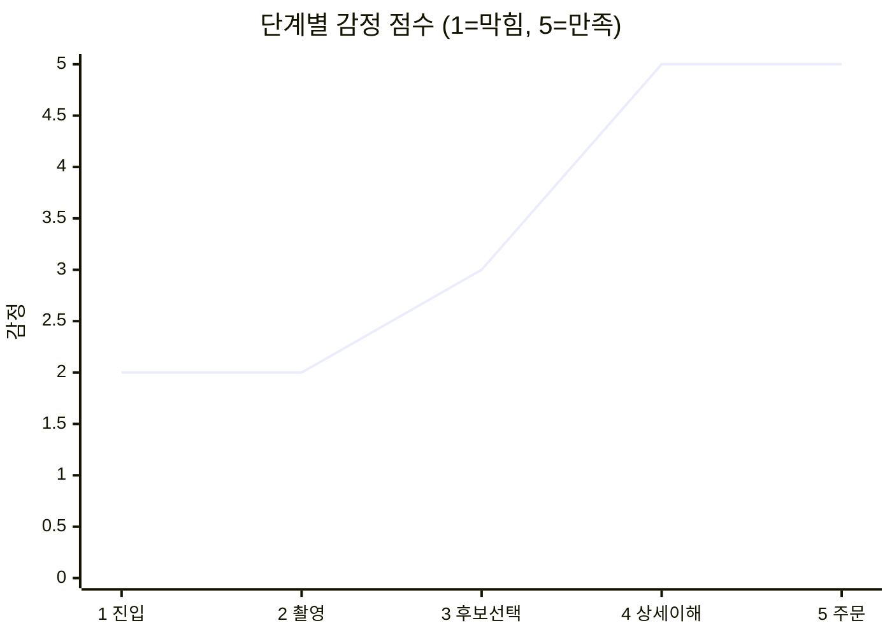
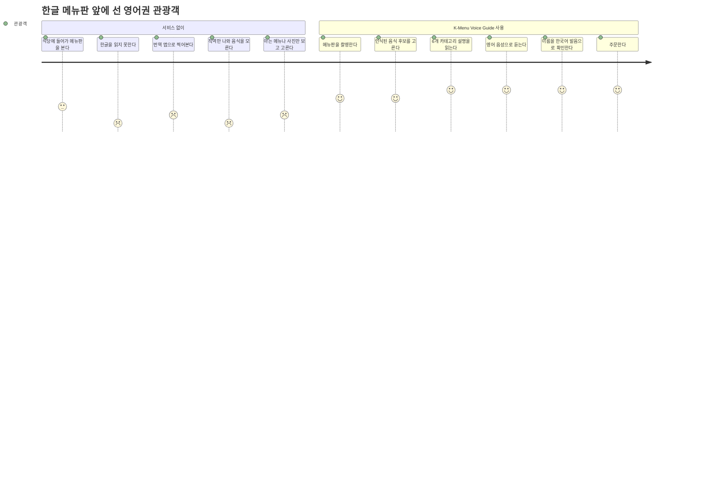

# 01. 고객여정지도 (Pain Point 정리)

> 제출물 1번 — 고객여정지도
>
> 근거: [`docs/기획서.md`](../기획서.md) 1장 · [`README.md`](../../README.md) 7장 ·
> 2026-08-25에 만든 제출용 정리본(`output/pdf/K-Menu-Voice-Guide_고객여정지도_제출용.pdf`, 저장소 미추적)
>
> 이전 정리본과의 차이: 가이드가 권장하는 **5열 구성**에 맞춰 `사용자 생각·감정` 열과 감정 점수를
> 추가했고, 장바구니·주문 요약 단계를 반영했다. 단계 구분과 페르소나는 이전 정리본을 이어받았다.

## 한 문장 문제 정의

> **한국 음식에 익숙하지 않은 영어권 개별 관광객은, 글자만 옮기는 기존 번역 앱 방식으로는
> 음식의 맛·재료·맵기·먹는 법을 알 수 없어 아는 메뉴만 고르거나 주문을 포기하게 되므로,
> 메뉴판 사진 한 장으로 음식 정보를 영어 텍스트와 음성으로 안내하는 서비스가 필요하다.**

---

## 1. 페르소나

| 항목 | 내용 |
|---|---|
| **사용자 특성** | Emma Wilson, 32세. 한국 첫 방문 영어권 개별 관광객(FIT). 한글을 읽지 못하고, 한국 음식 지식은 비빔밥·불고기 수준. 스마트폰 사용에는 익숙하다 |
| **사용 상황** | 서울 종로의 소규모 한식당. 점심 피크타임이라 직원은 바쁘고, 벽면 메뉴판은 한글 위주이며 음식 사진도 영어 설명도 없다 |
| **제약 조건** | 매운 음식 내성이 낮다. 해산물 알레르기 여부를 주문 전에 반드시 확인하고 싶다. 옆에서 설명해줄 사람이 없다 |
| **핵심 목표** | 낯선 메뉴를 빠르게 이해하고, 본인의 기호와 안전 기준에 맞는 음식을 자신 있게 고른다 |
| **기존 방식의 한계** | 번역 앱은 `곱창전골 → Beef intestine hot pot`처럼 **글자만 옮긴다.** 맛·조리 방식·먹는 법·매운 정도는 여전히 알 수 없다 |

**왜 이 사용자인가**: 방한 외국인 관광객은 2023년 1,103만 명 → 2025년 1,893만 명으로 늘었고,
음식점 소비 중 한식 비중이 80.6%로 가장 높다(제주관광공사·신한카드 빅데이터, 2023).
한글 메뉴판을 읽지 못해 주문에 실패한 사례는 여행 블로그 등 1차 자료에서도 확인된다
([Jaclynn Seah, "My Seoul Food Experience," 2024](https://theoccasionaltraveller.com/seoul-food/)).

---

## 2. 고객여정지도 (5열)

감정 점수는 1(막힘) ~ 5(만족). 점수가 낮은 칸이 곧 서비스가 개입해야 할 지점이다.

| # | 상황·단계 | 사용자 행동 | 사용자 생각·감정 | Pain Point | 서비스 개입 가능 지점 |
|:--:|---|---|---|---|---|
| 1 | **문제 인지 · 식당 진입** | 벽면 메뉴판과 가격표를 훑어보며 주문 가능한 항목을 파악한다. 번역 앱을 켤지 직원에게 물을지 잠시 고민한다 | "글자를 아예 못 읽겠다. 직원은 바쁜데 뭘 물어보지?" — 당황·부담 **(2점)** | 한글 중심 메뉴 환경과 음식 이미지 부재로 **정보 비대칭**이 발생한다. 초기 인지 부하가 높아 메뉴 탐색 효율이 떨어진다 | 첫 화면에서 "사진 한 장으로 음식 특징과 맵기를 확인할 수 있다"는 가치를 제시해 촬영으로 즉시 전환시킨다 |
| 2 | **메뉴판 촬영 · 업로드** | 스마트폰으로 메뉴판을 정렬해 촬영하거나 갤러리에서 업로드한다. 결과가 나올 때까지 화면을 주시한다 | "이렇게 찍으면 인식이 될까? 지금 처리 중인 건 맞나?" — 불안·대기 **(2점)** | 반사·원거리·작은 글씨·손떨림으로 **OCR 실패 가능성**이 있다. 대기 중에는 서비스가 정상 동작 중인지 확신하기 어렵다 | OpenCV 전처리 + 파인튜닝 OCR로 인식률을 높이고(매칭 재현율 91.67%), 분석 상태 피드백과 재촬영 가이드를 제공한다 |
| 3 | **OCR 후보 확인 · 메뉴 선택** | 인식된 음식 후보 목록에서 실제 메뉴판의 줄과 대응되는 항목을 고른다 | "이게 내가 보고 있는 그 메뉴가 맞나?" — 반신반의 **(3점)** | 유사한 메뉴명과 수식어 차이 때문에 **후보와 실제 메뉴를 연결하는 판단 부담**이 크다 | 번호 + 카드 UI로 후보를 보여주고 가격·썸네일·이름 음성을 함께 제공해 사용자가 직접 확인하고 고르게 한다. 등록되지 않은 음식은 **추측하지 않고 미지원으로 안내한다** |
| 4 | **음식 상세 이해 · 정보 해석** | 설명·재료·맵기·먹는 법·알레르기·발음 6개 카테고리를 확인하고, 내레이션 음성을 재생한다 | "아, 이런 음식이구나. 이 정도 맵기면 먹을 수 있겠다." — 이해·안도 **(5점)** | 직역 정보만으로는 실제 섭취 경험을 예측하기 어렵다. 특히 **맵기 체감·낯선 재료·정확한 발음**이 해석 장벽이 된다 | 6개 카테고리 상세 카드 + 맵기 5단계 불꽃 아이콘·스코빌 수치 + **맵기에 따라 톤이 갈리는 TTS**(GUIDE/CAUTION)를 함께 제공한다 |
| 5 | **메뉴 결정 · 주문** | 후보를 비교해 최종 결정하고 장바구니에 담는다. 주문 직전 이름 발음을 다시 듣고, 주문 요약을 직원에게 보여준다 | "이 이름을 어떻게 발음하지? 이대로 말하면 알아들을까?" → 확인 후 자신감 **(5점)** | 주문 직전까지 **발음 실수·맵기 오판·알레르기 누락**에 대한 불안이 남는다. 신뢰가 부족하면 탐색 단계로 되돌아간다 | 음식 이름만 한국어 발음으로 읽어주는 **별도 음성**과 장바구니 주문 요약을 제공해, 직접 발음하거나 화면을 보여줘 전달할 수 있게 한다 |

### 감정 곡선

### 서비스가 없을 때와의 대비

---

## 3. 왜 번역 앱만으로는 부족한가

| 서비스 | 분류 | 이 여정에서 못 푸는 것 |
|---|---|---|
| 파파고 · 구글 번역 | 범용 번역 | 2~4단계를 **글자 변환 하나로 뭉갠다.** 재료·맵기·먹는 법이 없어 4단계(정보 해석)에서 사용자가 그대로 막힌다 |
| 캐치테이블 영어버전 | 예약 앱 | 예약이 핵심이라 음식 정보 응답 기능이 없다. 1단계(식당 진입) 이후를 다루지 않는다 |
| 일반 TTS 서비스 | 음성 합성 | 한국 음식명을 영어 음운으로 읽어 **5단계(발음 확인)에서 틀린 발음을 준다** |

이 표가 곧 차별점의 근거다 — 우리는 **번역이 아니라 "이 음식이 무엇인가"를 답하고, 발음을
한국어 음운으로 읽어준다.**

---

## 4. 핵심 인사이트

### Pain Point TOP 3

1. **정보 비대칭** — 한글 메뉴판 환경에서 음식명 번역만으로는 음식 특성을 이해할 수 없다 (1·4단계)
2. **선택 불확실성** — 유사 메뉴명·수식어 차이로 OCR 후보와 실제 메뉴를 연결하는 부담이 크다 (3단계)
3. **위험 정보 해석** — 맵기·알레르기는 선호가 아니라 **안전** 문제라 신뢰 민감도가 높다 (4·5단계)

### 여기서 도출된 설계 결정

| 인사이트 | 서비스에 반영된 방식 | 확인 |
|---|---|---|
| 대기 중 불안(2단계) | 분석 상태 피드백 · 실패 시 재촬영 가이드 | [`docs/specs/api-layer.md`](../specs/api-layer.md) EC-01~EC-10 |
| 후보 연결 부담(3단계) | 번호+카드 UI, 사용자가 직접 선택 · 미등록은 추측하지 않음 | [`docs/specs/ocr-candidate-results.md`](../specs/ocr-candidate-results.md) |
| 안전 정보 신뢰(4단계) | 설명을 LLM으로 생성하지 않고 팀이 작성한 DB 문장만 조회 → **환각 차단** | [`docs/기획서.md`](../기획서.md) 2장 |
| 맵기 경고(4단계) | `spice_level` ≥ 4면 TTS 스타일이 자동으로 CAUTION | [`docs/specs/text-generation.md`](../specs/text-generation.md) |
| 발음 불안(5단계) | 음식 이름만 읽는 별도 음성 + TTS 입력을 한글 표기로 치환 | [`eval/TTS_MODULE.md`](../../eval/TTS_MODULE.md) 4절 |

### 발표에서 강조할 지점

- **Moment of Truth**: 4단계 — 후보가 실제 메뉴와 맞는다고 인지하고 상세 설명을 읽으며
  "이제 무엇을 주문할지 알겠다"고 느끼는 순간
- **이탈 가능성이 가장 높은 구간**: 2단계(촬영·업로드) — 핵심 가치가 드러나기 전에 대기와
  실패 가능성이 동시에 발생한다
- **최종 가치**: 낯선 한글 메뉴를 **"안심하고 주문할 수 있는 선택지"로 재구성**하는 것

---

## 5. 이 여정에서 다루지 않는 것

가이드는 STT를 요구하지만, 이 여정지도에는 **음성 질문 입력 단계가 없다.** 기획 초기 후보였으나
범위에서 제외했고(`docs/기획서.md` 3장), 그 근거는 [07. 발표자료 원고](07-presentation-outline.md)의
"무엇을 뺐는가" 절에서 다룬다. 여정지도에 없는 단계를 있는 것처럼 그리지 않는다.

제외된 다른 단계: 실시간 통역, 주문·결제 전송, 사용자 음식 등록, 영어 이외 다국어.
