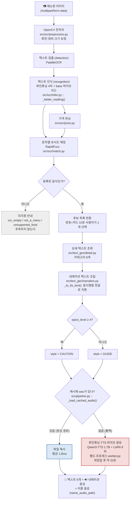
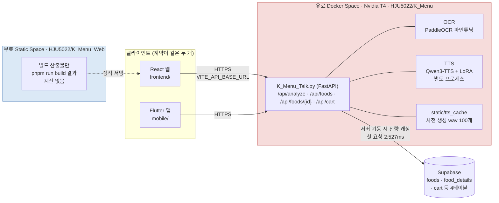

# 02. 전체 파이프라인 구조도 (아키텍처)

> 제출물 2번 — 전체 파이프라인 구조도
>
> 근거: [`README.md`](../../README.md) 4장 · [`docs/specs/api-layer.md`](../specs/api-layer.md) ·
> [`docs/specs/fastapi-space-deploy.md`](../specs/fastapi-space-deploy.md) ·
> [`frontend/space/README.md`](../../frontend/space/README.md) · [`docs/기획서.md`](../기획서.md) 6-3

## 1. 데이터 흐름도 — 사진 한 장에서 음성까지

굵은 경로가 실제 사용자가 타는 길이다. **캐시 히트(파란 경로)와 라이브 생성(빨간 경로)을
구분해 그렸다** — 둘의 응답 시간이 1,000배 이상 차이 나기 때문이다.

### 캐시 경로와 라이브 경로를 나눈 이유

RTF(Real-Time Factor) 실측이 **1.47**이었다 — 10초짜리 음성을 만드는 데 14.7초가 걸린다는 뜻으로,
1.0을 넘으면 실시간 생성이 원리적으로 불가능하다. TTFB 목표 5~7초에 하드웨어 교체로는 닿을 수
없다고 판단해, **등록 음식 50개 × 스타일을 미리 생성해 캐시에 넣었다**(`src/tts/pregenerate.py`).
라이브 생성 경로는 지운 것이 아니라 **캐시 미스 시의 폴백**으로 남겨두었다.

| 경로 | 실측 | 언제 타는가 |
|---|---|---|
| 캐시 히트 (파란색) | **평균 1.8ms** (n=50) | 등록 음식 50개 — 정상 경로 |
| 라이브 생성 (빨간색) | 워밍업 후 33초 / 콜드 61.3초 | 캐시 파일이 없을 때만 |
| 서버 기동 후 첫 요청 | +2,527ms | Supabase 4테이블 최초 로드. 두 번째 요청부터 사라진다 |

근거: [08. 모델 비교 실험](08-model-experiments.md) 3절 · [`eval/model_comparison.md`](../../eval/model_comparison.md) 3절

---

## 2. 배포 구조도 — GPU를 어디에 둘 것인가

### 왜 Space를 둘로 나눴나

**웹에도 계산을 두면 GPU 비용이 두 배가 되기 때문이다.** 계산(OCR·TTS)은 유료 GPU Docker
Space 한 곳에 몰고, 웹은 그 API를 부르기만 하는 무료 static Space에 빌드 산출물만 올린다.
static SDK는 컨테이너 빌드 단계가 없어 배포가 몇 초에 끝난다는 부수 효과도 있다.

GPU가 필요하다는 판단 자체도 측정에서 나왔다 — **OCR 92상자 처리: CPU 22.8초 vs GPU 0.8초**
(2026-08-23, RTX 3080 Ti). 28배 차이라 계산을 CPU에 둘 수는 없었다.
ZeroGPU(무료 GPU)는 **PyTorch 전용 메커니즘이라 PaddleOCR이 GPU를 못 써서** 쓸 수 없었고
(조사 2026-08-21), 그래서 전용 T4를 붙였다.

웹과 앱은 같은 HTTP 계약([`docs/specs/api-layer.md`](../specs/api-layer.md))을 쓰는 **대등한 두
클라이언트**다. 한쪽이 다른 쪽을 대체하지 않는다.

### 가이드 원칙 2(추론은 엣지에서, 서버는 IO만)와의 관계

가이드 7장 원칙 2는 *"디바이스가 추론하고 서버는 저장·집계만"* 을 권한다. **우리는 반대로 갔고,
그 이유를 측정으로 설명할 수 있다.**

| 원칙 2가 전제하는 상황 | 우리 상황 |
|---|---|
| 모델이 기기에서 돌 만큼 가볍다 | PaddleOCR 파인튜닝 + Qwen3-TTS 1.7B는 모바일 온디바이스로 못 올린다 |
| 실시간 연속 추론이 필요하다 (FPS 단위) | **질문했을 때만 1회 응답한다** — 사진 한 장에 한 번. 통신 왕복이 병목이 아니다 |
| 서버 왕복이 지연의 주범이다 | 우리 지연의 주범은 **모델 추론 시간(RTF 1.47)** 이었고, 이건 서버·엣지 어디서도 같다 |

원칙 2의 목적은 "누적 지연을 없애 실시간을 지킨다"인데, 우리는 **시나리오를 실시간에서 1회 응답으로
좁히고(원칙 3), 그 대신 추론 자체를 사전 생성으로 없앴다**(캐시 1.8ms). 즉 원칙 2를 어긴 것이 아니라,
같은 목적을 우리 제약(무거운 모델 · 비실시간 시나리오 · GPU 비용)에 맞는 다른 수단으로 달성했다.
대신 원칙 2가 요구하는 역할 분리는 **Space 2분할**로 지켰다 — 계산 Space와 화면 Space가 완전히 분리돼 있다.

---

## 3. 세 블록의 입출력 계약

| 단계 | 모듈 | 입력 | 출력 |
|---|---|---|---|
| 1 | [`src/ocr/`](../../src/ocr/) | 메뉴판 이미지 | 음식 후보 목록 (`food_id`, `name_kr`, `name_en`, `score`, 가격) |
| 2 | [`src/text_gen/`](../../src/text_gen/) | 선택된 `food_id` | 상세 텍스트 6개 + 내레이션 텍스트 1개 + `style` |
| 3 | [`src/tts/`](../../src/tts/) | 내레이션 텍스트 + 스타일 | WAV 음성 |

블록이 서로를 직접 호출하지 않고 [`src/pipeline.py`](../../src/pipeline.py)가 조립한다.
TTS는 **별도 프로세스**(`src/tts/worker.py`)로 격리돼 있는데, PaddleOCR(paddle)과 TTS(torch)를
한 프로세스에 올리면 충돌하기 때문이다.

## 4. API 계약 요약

| 메서드 · 경로 | 역할 |
|---|---|
| `POST /api/analyze` | 이미지 업로드 → OCR 상태 + 후보 목록 |
| `GET /api/foods` | 지원 음식 50개 목록 |
| `GET /api/foods/{food_id}` | 상세 6카테고리 + 내레이션 텍스트 · 스타일 · 오디오 경로 |
| `GET · DELETE /api/cart`, `POST /api/cart/items` | 장바구니 조회·비우기·담기 |
| `/audio/*` | 생성·복사된 wav 정적 서빙 |

엣지 케이스 10종(EC-01~EC-10)의 처리 방식은 [`docs/specs/api-layer.md`](../specs/api-layer.md)에 있고,
[04. 파이프라인 노드 설명](04-pipeline-nodes.md)의 실패 동작 열과 대응된다.

---

## 5. 그림 파일

Mermaid 원본은 이 문서에 그대로 들어 있다(GitHub에서 바로 렌더된다). 발표자료·PDF에 넣을 PNG가
필요하면 GitHub 렌더 화면을 캡처하거나 [mermaid.live](https://mermaid.live)에 위 코드를 붙여
내보낸다. **별도 PNG 파일은 만들지 않았다** — 텍스트로 두면 수정이 쉽고 문서와 그림이 어긋나지 않는다.
