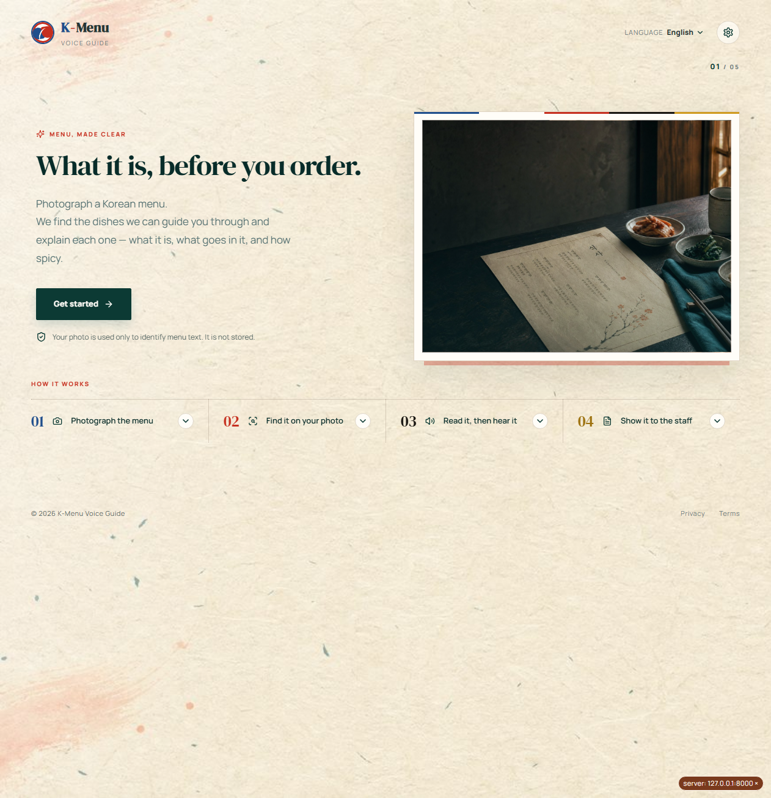
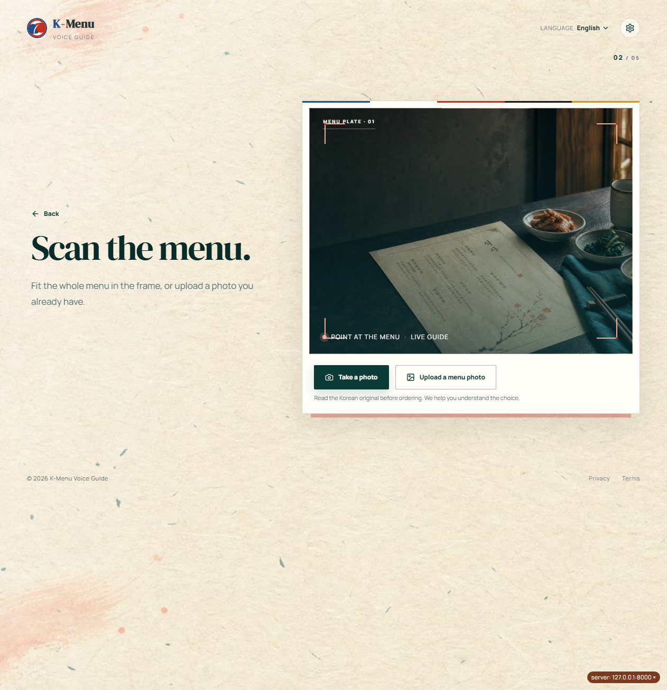
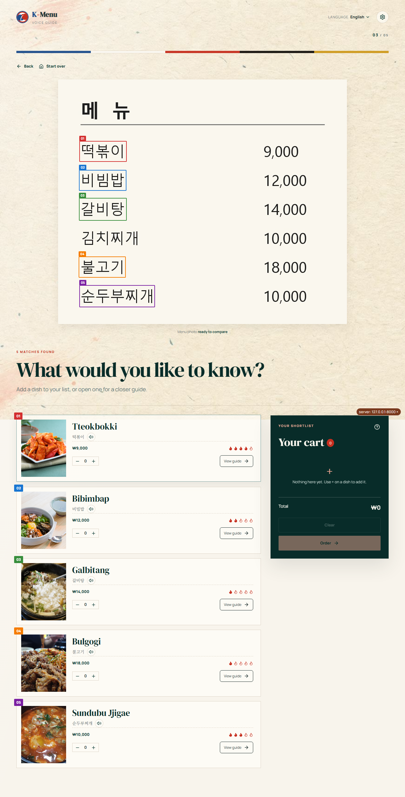
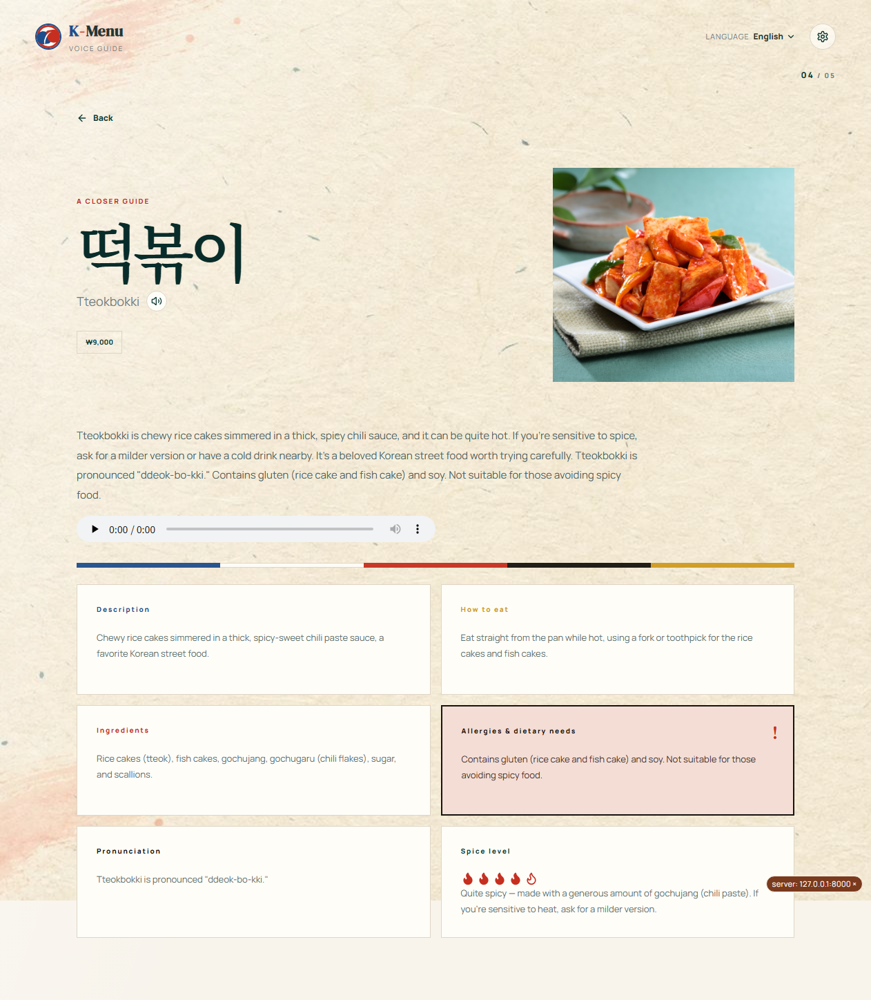
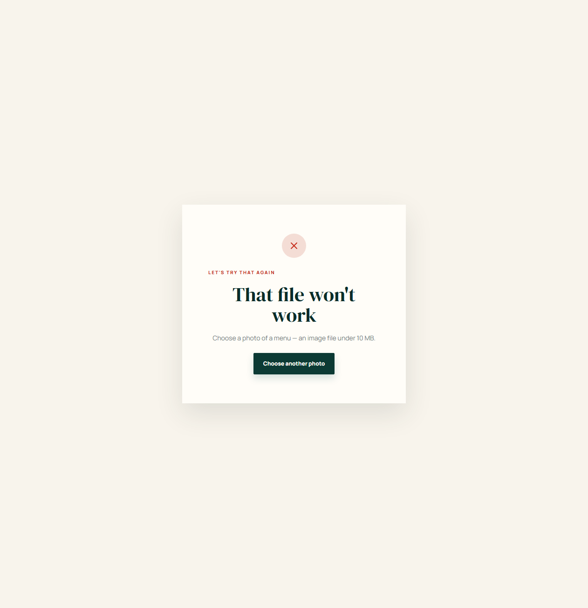
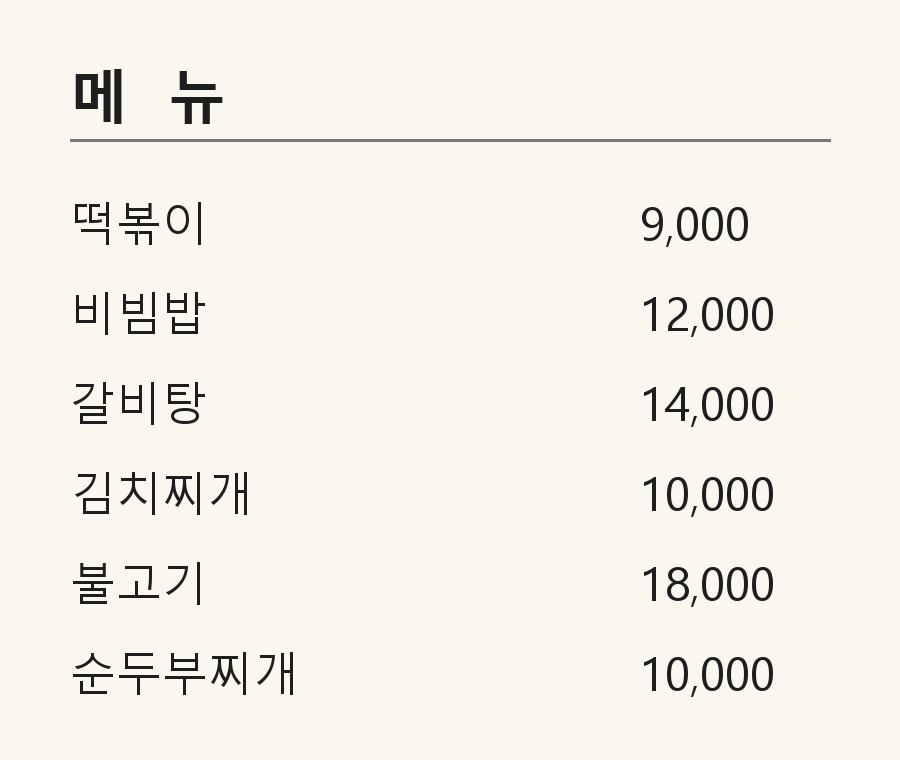

# 04. 파이프라인 구성 캡처 및 노드 설명

> 제출물 4번 — 파이프라인 구성 캡처 및 노드 설명
>
> 아래 캡처는 **실제로 돌린 앱을 찍은 것**이다. 로컬에 API 서버(`K_Menu_Talk.py`)와 웹 빌드본을
> 띄우고, 합성 메뉴판 이미지를 올려 OCR → 매칭 → 상세 → TTS 캐시 히트까지 전부 실행한 결과다
> (2026-08-26 측정, 로컬 CPU 환경).

## 1. 실행 화면 캡처

### ① 소개 화면 (핵심 조건 4번 — 소개 페이지)



서비스가 무엇을 하는지 4단계로 보여준다(Photograph the menu → Find it on your photo →
Read it, then hear it → Show it to the staff). 사진이 저장되지 않는다는 안내를 첫 화면에 둔다.

### ② 촬영·업로드 화면



촬영(`Take a photo`)과 갤러리 업로드(`Upload a menu photo`)를 둘 다 제공한다. 모바일에서는
`capture="environment"`로 후면 카메라가 바로 열린다.

### ③ 후보 목록 화면



**이 캡처 한 장에 이 프로젝트의 설계가 다 들어 있다.**

- 업로드한 메뉴판 위에 OCR이 찾은 **음식명 박스를 번호·색으로 겹쳐** 보여준다 → 사용자가
  "이 후보가 메뉴판의 어느 줄인지" 눈으로 확인한다 (고객여정 3단계의 pain point 대응)
- 5개가 매칭됐고 **`김치찌개` 한 줄은 박스가 없다** — OCR이 `召大|`로 잘못 읽어 매칭에 실패한
  실제 사례다. 추측해서 채우지 않고 조용히 빠진다
- 후보마다 가격(₩9,000)·맵기 불꽃 아이콘·이름 듣기 버튼(🔊)·수량 담기(−/+)가 붙는다

### ④ 음식 상세 화면



6개 카테고리 카드(Description · How to eat · Ingredients · Allergies & dietary needs ·
Pronunciation · Spice level)와 내레이션 음성 플레이어. **알레르기 카드만 붉은 테두리와 경고
아이콘으로 강조**된다 — 안전 정보이기 때문이다. 맵기는 불꽃 4/5개로 표시되고, 이 값이 4 이상이라
TTS 스타일이 자동으로 CAUTION이 됐다.

> 오디오 플레이어가 `0:00 / 0:00`인 것은 헤드리스 캡처라 브라우저가 오디오 메타데이터를
> 읽지 않았기 때문이다. API 응답은 `tts_status: "ok"`, `narration_audio_path`가 채워져 있다.

### ⑤ 오류 안내 화면



이미지가 아닌 파일(`.txt`)을 올렸을 때. *"That file won't work — Choose a photo of a menu,
an image file under 10 MB."* 서버가 400으로 답하고(EC-07) 화면은 **다시 시도할 방법**을 준다.
서버 장애(500)와 사용자 입력 문제(400)를 구별해 다른 안내를 띄운다.

### 캡처에 쓴 입력 이미지



실제 식당 메뉴판 사진은 저작권·초상 문제가 있고, 팀이 쓰는 테스트셋(`OCR_test_set_50`)은
`data/` 아래라 저장소에 없다. 그래서 **합성 메뉴판을 만들어 입력으로 썼다**(6줄 · 맑은고딕 ·
실제 가격 표기). `eval/measure_digits.py`가 가격 벤치마크에 쓰는 방식과 같다.

---

## 2. 노드별 설명

각 노드의 입력·처리·출력·구현 위치·실패 동작을 정리한다. 실패 동작은
[`docs/specs/api-layer.md`](../specs/api-layer.md)의 EC 번호와 대응된다.

### 노드 1 — 이미지 전처리

| 항목 | 내용 |
|---|---|
| 입력 | 업로드된 이미지 파일 경로 |
| 처리 | 기울기 보정(`_deskew`) → 대비 향상(`_enhance_contrast`) → 긴 변 기준 리사이즈(`_resize`). 원본 좌표로 되돌릴 `SourceMapping`을 함께 만든다 |
| 출력 | 전처리된 ndarray + 좌표 매핑 |
| 구현 | [`src/ocr/preprocess.py`](../../src/ocr/preprocess.py) :: `preprocess_image_with_mapping()` |
| 실패 시 | 이미지를 못 읽으면 400 "사진을 읽을 수 없습니다" (EC-02) |

좌표 매핑을 유지하는 이유는 ③ 캡처의 **박스 오버레이를 원본 사진 위에 그려야** 하기 때문이다.

### 노드 2 — 텍스트 검출 (detection)

| 항목 | 내용 |
|---|---|
| 입력 | 전처리된 이미지 |
| 처리 | PaddleOCR detection으로 글자 박스를 찾는다 (엔진은 최초 1회만 로드) |
| 출력 | 박스 좌표 목록 |
| 구현 | [`src/ocr/infer.py`](../../src/ocr/infer.py) :: `_load_det_engine()` |
| 실패 시 | 박스가 하나도 없으면 `ocr_empty` → 재촬영 안내 (EC-04) |

### 노드 3 — 텍스트 인식 (recognition) · **하이브리드**

| 항목 | 내용 |
|---|---|
| 입력 | 검출된 박스의 크롭 이미지 |
| 처리 | **같은 크롭을 파인튜닝 모델과 base 모델에 각각 넣고, 조각별로 더 나은 쪽을 고른다.** 한글이 없는 조각(가격·숫자)은 base 결과를 채택한다. 세로쓰기는 회전본도 인식해 비교한다 |
| 출력 | 조각별 인식 문자열 + 신뢰도 |
| 구현 | `infer.py` :: `_recognize_crops()` · **`_better_reading()`** · `_recognize_vertical_crop()` |
| 실패 시 | 신뢰도가 낮은 조각은 매칭 단계에서 걸러진다 |

**이 노드가 이 프로젝트에서 가장 중요한 엔지니어링 판단이다.** 파인튜닝 모델은 음식명을 잘 읽는
대신 숫자 인식을 잃었다(완전일치 77.78% → 5.56%). 모델을 되돌리는 대신 **조각 단위로 두 모델을
갈아끼워** 배포 경로 숫자 정확도를 base와 동일하게(77.78%) 복구했다.
근거: [08. 모델 비교 실험](08-model-experiments.md) 1-3절

### 노드 4 — 가격 파싱

| 항목 | 내용 |
|---|---|
| 입력 | 인식 문자열 |
| 처리 | 천 단위 구분·통화기호·축약 표기(`12.00`)를 금액으로 복원. 숫자 오인식 글자를 교정(`repair_digit_lookalikes`) |
| 출력 | `price_krw` (정수) |
| 구현 | [`src/ocr/price.py`](../../src/ocr/price.py) |
| 실패 시 | 금액을 못 만들면 후보에서 가격만 비운다 (음식 매칭은 계속된다) |

### 노드 5 — 음식명 매칭

| 항목 | 내용 |
|---|---|
| 입력 | 인식된 박스들 |
| 처리 | 박스를 메뉴 줄 단위로 묶고, 등록 음식 50개와 RapidFuzz 유사도로 비교한다. 수식어(`매운`·`대`)를 분리하고, 부분 일치·유사 이름 오탐을 걸러낸다 |
| 출력 | 후보 목록 (`food_id`, 이름, `score`, 가격, 원본 박스 좌표) |
| 구현 | [`src/ocr/match.py`](../../src/ocr/match.py) :: `scan_menu_lines()` · `match_food_candidates_by_line()` · `name_score()` |
| 실패 시 | 가격 붙은 메뉴 줄이 없으면 `not_a_menu`(EC-05), 등록 음식이 없으면 `unsupported_food` — **추측하지 않는다** |

**OCR이 글자를 틀려도 이 노드가 건진다.** 라벨 완전일치는 66.67%인데 매칭 재현율은 91.67%다.

### 노드 6 — 상세 텍스트 조회

| 항목 | 내용 |
|---|---|
| 입력 | 선택된 `food_id` |
| 처리 | Supabase에 미리 넣어둔 카테고리 6종(+음성 전용 `PRONUNCIATION_TTS`)을 조회한다. **외부 LLM을 호출하지 않는다** |
| 출력 | 카테고리별 영어 문장 |
| 구현 | [`src/text_gen/detail.py`](../../src/text_gen/detail.py) :: `get_details()` |
| 실패 시 | 없는 `food_id`는 404 (EC-01) |

LLM으로 생성하지 않는 이유는 **알레르기·재료에서 환각이 나오면 안전 문제**가 되기 때문이다.

### 노드 7 — 내레이션 조립 + 스타일 결정

| 항목 | 내용 |
|---|---|
| 입력 | `food_id`, 상세 텍스트 |
| 처리 | 화면용 텍스트와 **TTS용 텍스트를 따로** 만든다. TTS용은 음식명을 한글로 치환(`Tteokbokki` → `떡볶이`)하고 발음 안내를 `PRONUNCIATION_TTS`로 갈아끼운다. `spice_level ≥ 4`면 `style = CAUTION` |
| 출력 | `text`, `tts_text`, `style` |
| 구현 | [`src/text_gen/narration.py`](../../src/text_gen/narration.py) :: `get_narration()` · `_to_tts_text()` |
| 실패 시 | 이름 치환은 단어 경계 매칭이라 실패해도 원문이 그대로 나간다 |

**입력 조건(맵기)이 출력 음성을 바꾸는 지점**이 여기다 — 사용자가 스타일을 고르지 않는다.

### 노드 8 — TTS (캐시 우선, 라이브 폴백)

| 항목 | 내용 |
|---|---|
| 입력 | `tts_text` + `style` |
| 처리 | `static/tts_cache/food_{id}_{STYLE}.wav`를 먼저 찾는다. 있으면 복사만 하고, 없으면 별도 프로세스에서 라이브 생성한다 |
| 출력 | `/audio/*.wav` 경로 + `tts_status` + `tts_latency_ms` |
| 구현 | [`src/pipeline.py`](../../src/pipeline.py) :: `_load_cached_audio()` · `_synthesize_via_subprocess()` → [`src/tts/worker.py`](../../src/tts/worker.py) → [`src/tts/infer.py`](../../src/tts/infer.py) |
| 실패 시 | 모델이 준비 안 되면 `tts_status: "not_ready"`를 그대로 응답에 담아 전달 — **예외로 바꾸지 않는다.** 화면은 텍스트를 먼저 보여준다 (EC-03) |

TTS를 별도 프로세스로 격리한 이유는 PaddleOCR(paddle)과 TTS(torch)를 한 프로세스에 올리면
충돌하기 때문이다.

### 노드 9 — 이름 음성

| 항목 | 내용 |
|---|---|
| 입력 | `food_id`, `name_kr` |
| 처리 | 음식 이름만 한국어 발음으로 읽은 `name_{id}.wav`를 캐시에서 찾는다 |
| 출력 | `name_audio_path` + `name_tts_status` |
| 구현 | `src/pipeline.py` :: `_name_audio()` |
| 실패 시 | `name_tts_status`만 실패로 내려가고 나머지 응답은 정상 |

고객여정 5단계(주문 직전 발음 불안)에 직접 대응하는 노드다.

### 노드 10 — API 레이어

| 항목 | 내용 |
|---|---|
| 입력 | HTTP 요청 |
| 처리 | `POST /api/analyze` · `GET /api/foods` · `GET /api/foods/{id}` · `GET·DELETE /api/cart` · `POST /api/cart/items`. 업로드는 content-type → 크기(10MB) → 내용 순으로 검사한다 |
| 출력 | JSON + `/audio` 정적 서빙 |
| 구현 | [`K_Menu_Talk.py`](../../K_Menu_Talk.py) |
| 실패 시 | EC-07 이미지 아님 400 · EC-08 0바이트 400 · EC-09 10MB 초과 413 · EC-10 임시 파일은 `finally`에서 정리 |

### 노드 11 — DB 캐시

| 항목 | 내용 |
|---|---|
| 입력 | 서버 기동 |
| 처리 | 첫 요청에서 Supabase 4개 테이블을 한 번에 읽어 메모리에 올린다 |
| 출력 | 이후 요청은 DB 왕복 없음 |
| 구현 | [`src/db/cache.py`](../../src/db/cache.py) · [`docs/specs/db-cache.md`](../specs/db-cache.md) |
| 실패 시 | Supabase 연결 실패 시 오류 로깅 후 안내 (무료 티어 7일 비활동 정지 대비) |

**첫 요청 2,527ms의 정체가 이 노드다** — TTS가 아니라 DB 첫 로드가 콜드 비용의 전부다.

### 노드 12 — 웹 화면

| 항목 | 내용 |
|---|---|
| 입력 | 사용자 조작 |
| 처리 | 계산을 하지 않는다. API를 부르고 결과를 그린다. 서버 주소는 `VITE_API_BASE_URL` 하나로만 받고, `?api=`로 이 브라우저에서만 임시 전환할 수 있다 |
| 출력 | 화면 |
| 구현 | [`frontend/client/src/pages/Landing.tsx`](../../frontend/client/src/pages/Landing.tsx) · [`Home.tsx`](../../frontend/client/src/pages/Home.tsx) · [`lib/api.ts`](../../frontend/client/src/lib/api.ts) |
| 실패 시 | 연결 실패·서버 오류·입력 오류를 각각 다른 화면으로 안내 |

---

## 3. 실측 (2026-08-26, 로컬)

이번 캡처를 뜨면서 같은 환경에서 잰 값이다.

| 구간 | 실측 | 조건 |
|---|---|---|
| `POST /api/analyze` (첫 요청) | **73.9초** | 모델 로드 포함 |
| `POST /api/analyze` (워밍업 후) | **22.4초** · 73.6초 | 편차가 크다 |
| `GET /api/foods/{id}` 왕복 | **0.022초** | 서버 처리 + 네트워크 |
| TTS 캐시 히트 (`tts_latency_ms`) | **4.91ms** (떡볶이/CAUTION) · **6.45ms** (비빔밥/GUIDE) | 파일 복사 |

> ⚠️ **이 머신의 PaddleOCR은 CPU 빌드다** (`paddle.device.is_compiled_with_cuda() == False`).
> 위 분석 시간은 **CPU 실측**이며 배포 환경(T4 GPU)과 다르다. 팀이 앞서 잰
> "OCR 92상자 CPU 22.8초 vs GPU 0.8초"(2026-08-23)와 같은 자릿수다.
> 배포 T4 참고값은 상세 응답 캐시 히트 시 0.83초였다(`README.md` 5장).

## 4. 재현 방법

```bash
python -m uvicorn K_Menu_Talk:app --host 127.0.0.1 --port 8000
```

```bash
cd frontend/dist/public && python -m http.server 4173
```

브라우저에서 `http://127.0.0.1:4173/?api=http://127.0.0.1:8000`을 연다. `?api=`는 이 브라우저에만
저장되는 임시 서버 주소 전환이다(`frontend/client/src/lib/api.ts`).
