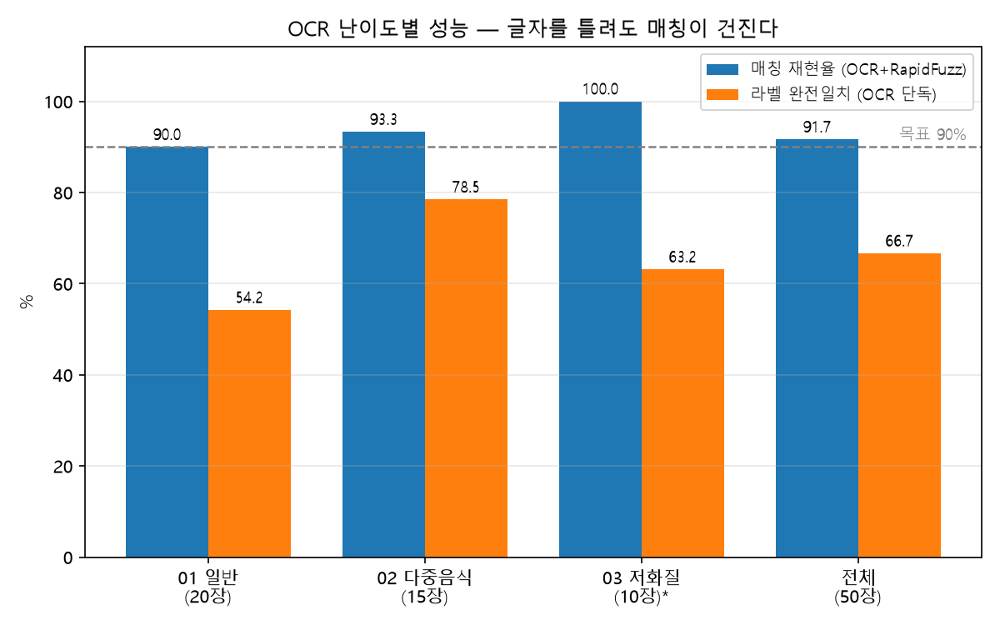
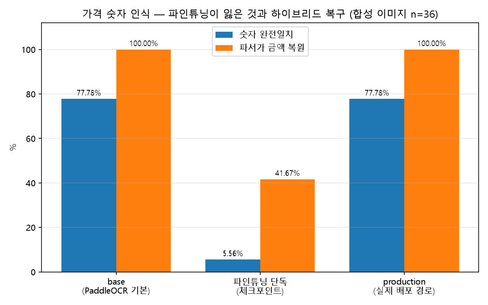
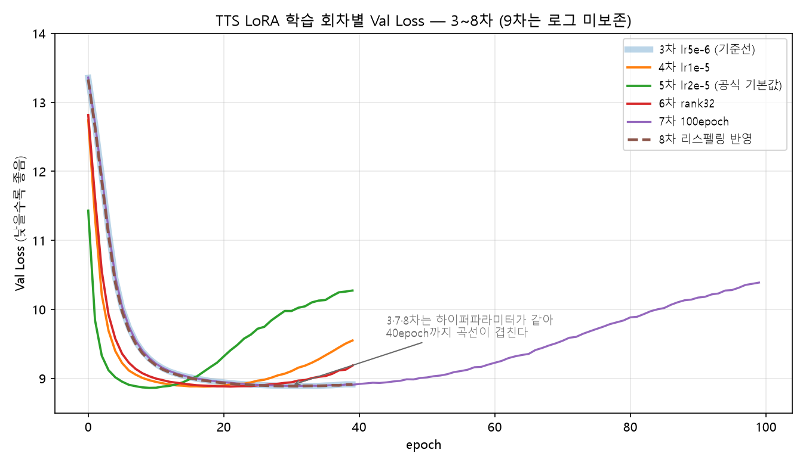
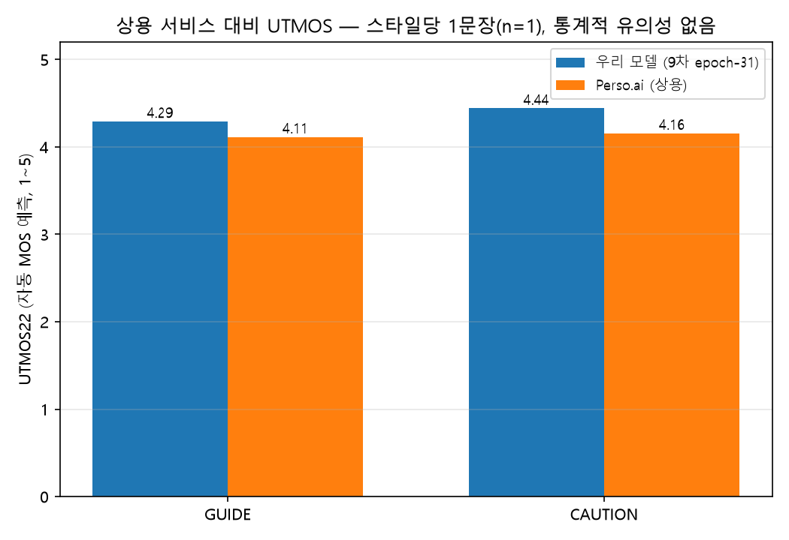
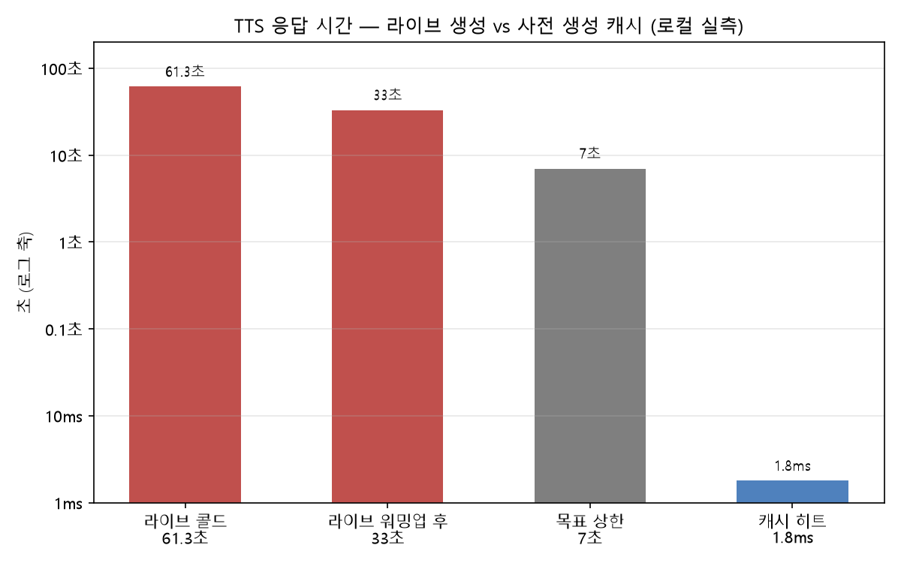

# 08. 모델 비교 실험 결과

> 제출물 8번 — 모델 비교 실험 결과 (정량 지표 + 정성 평가)
>
> 이 문서의 모든 수치는 저장소의 측정 결과 파일에서 그대로 가져왔다. 표마다 출처 파일과
> 측정 조건을 적었고, **재지 못한 칸은 "미측정"으로 남겼다.**
> 그래프 생성 스크립트: [`assets/make_charts.py`](assets/make_charts.py) (원본 CSV·JSON을 읽어 그리기만 한다)

## 요약 — 무엇을 고르고 무엇을 잃었나

| 모듈 | 최종 선택 | 근거 | 대가 |
|---|---|---|---|
| OCR | PaddleOCR 파인튜닝 4차 + base 하이브리드 | 음식명 매칭 91.67% (목표 90%) | 파인튜닝 단독은 가격 숫자를 잃음 → 조각 단위 하이브리드로 복구 |
| TTS | Qwen3-TTS 1.7B Base + LoRA 9차 `epoch-31` | Val Loss 8.8919 (1차 대비 −18%) · Perso.ai 대비 104~107% | 사람 MOS 미완 · 현행 설정 UTMOS 미측정 |
| 서빙 | 사전 생성 캐시(Plan B) | 라이브 33초 → 캐시 1.8ms | 등록 음식 50개 고정에서만 성립 |

---

## 1. OCR — 한국어 음식명 인식

### 1-1. 모델별 비교

| 모델 | 매칭 재현율 | 라벨 완전일치 | 검증 정확도 | 비고 |
|---|---|---|---|---|
| 기본 PaddleOCR (base) | **미측정** | **미측정** | — | 비교 기준선. `eval/measure_ocr.py --rec paddle-base`로 같은 코드로 잴 수 있으나, 테스트셋 `OCR_test_set_50`이 `data/` 아래라 git에 없다 → **원본 데이터를 가진 PC에서만** 실행된다 |
| **파인튜닝 4차 (최종 배포)** | **91.67%** | **66.67%** | 90.98% | 2026-08-21 실측, 세로쓰기 회전 보정 등 후처리 반영 |
| (참고) 후처리 반영 전 측정 | 97.22% | 42.94% | — | 측정 스크립트 미보존 — 판정 기준 재확인 불가 |

- 테스트셋: `OCR_test_set_50` — 실제 메뉴판 사진 50장 (01_normal 20 · 02_multi_food 15 · 03_low_quality 10 · 04_unregistered 5), 정답 라벨 `manifest.json`
- **매칭 재현율** 정의: 매칭 대상이 있는 36장 중, `src/ocr/match.py`가 정답 라벨과 일치하는 등록 음식 후보를 1개 이상 반환한 비율
- **라벨 완전일치** 정의: 전체 정답 라벨 중 OCR 원문에 그대로 포함된 비율
- 측정 스크립트: [`eval/measure_ocr.py`](../../eval/measure_ocr.py) · 결과 원본: [`eval/measure_ocr_final.json`](../../eval/measure_ocr_final.json)

> ⚠️ **base 기준선이 비어 있는 것이 이 표의 가장 큰 약점이다.** "파인튜닝이 얼마나 나아졌는가"를
> 같은 테스트셋에서 직접 보이지 못한다. 측정 코드는 커밋돼 있으므로 테스트셋이 있는 PC에서
> 한 번 돌리면 채워진다.

### 1-2. 난이도별 성능 — 왜 OCR 단독 성능을 목표로 잡지 않았나

| 카테고리 | 장수 | 라벨 완전일치 | 라벨 CER | 매칭 재현율 |
|---|---|---|---|---|
| 01_normal | 20 | 54.24% | 29.45% | 90.0% |
| 02_multi_food | 15 | 78.49% | 26.61% | 93.3% |
| 03_low_quality | 10 | 63.16% | 35.53% | 100.0%* |
| 04_unregistered | 5 | 16.67% | 47.65% | — (매칭 대상 없음) |
| **전체** | **50** | **66.67%** | **29.23%** | **91.67%** |

\* 저화질 10장 중 매칭 대상이 1장뿐이라 표본이 작다 — 100%를 성능 근거로 쓰지 않는다.

**라벨 완전일치(66.67%)보다 매칭 재현율(91.67%)이 25%p 높은 것**이 이 설계의 핵심이다.
OCR이 글자를 틀려도 RapidFuzz 유사도 매칭이 등록 음식 50개 중 정답을 찾아낸다. 목표를
OCR 단독 성능이 아니라 **OCR + 매칭의 합**으로 잡았기 때문에 90% 기준을 넘겼다.

> **CER 두 개를 혼동하지 말 것** — 위 표의 라벨 CER 29.23%는 *메뉴판 사진 50장의 정답 라벨* 기준이고,
> `eval/model_comparison.md`가 인용하는 CER 2.50%는 *AI Hub 검증셋 6,500장(절단된 글자박스)* 기준이다
> (`train.log`의 `norm_edit_dis 0.9750`). 측정 대상이 달라 같은 축에 놓을 수 없다.

### 1-3. 파인튜닝의 대가 — 가격 숫자 인식 붕괴

음식명은 좋아졌지만 **가격 숫자를 읽는 능력을 잃었다.** 같은 이미지를 detection에 한 번만
넣고 나온 **같은 박스·같은 크롭**을 인식 모델만 바꿔 먹인 결과다 — 전처리·검출이 동일하므로
차이는 인식 모델 자체에서 온다.

| 인식기 | 숫자 완전일치 | 숫자 CER | 파서가 금액 복원 |
|---|---|---|---|
| base (PaddleOCR 기본) | 77.78% | 3.44% | 100% |
| 파인튜닝 체크포인트 단독 | **5.56%** | **37.18%** | 41.67% |
| **production (실제 배포 경로)** | **77.78%** | **3.44%** | **100%** |

- **원인**: catastrophic forgetting. 등록 음식 50개에 쓰인 글자만 모은 커스텀 딕셔너리로 학습해
  라벨에 없던 숫자·통화기호를 읽는 능력이 사라졌다. 실패 형태가 그대로 드러난다 —
  `9,000` → `C0`, `12,000` → `12.00`, `₩7,000` → `000`
- **대응**: [`src/ocr/infer.py`](../../src/ocr/infer.py)의 `_better_reading()`이 **한글이 없는 조각은
  base 인식 결과를 채택**한다. 두 인식기를 조각 단위로 갈아끼우는 하이브리드다.
- **결과**: 배포 경로 수치가 base와 같다 — 파인튜닝의 손실이 사용자에게 도달하지 않는다.
- 테스트셋: 가격 문자열을 직접 그려 넣은 **합성 이미지 36개** (글꼴 3종 × 흐림 3단계 × 표기 4종).
  실제 메뉴판 사진에는 가격 정답 라벨이 없어 합성으로 정답을 확보했다.
- 측정: `python eval/measure_digits.py` — GPU·외부 테스트셋 없이 재현된다. 원본: [`eval/measure_digits.json`](../../eval/measure_digits.json)

**그래서 무엇을 골랐나**: 파인튜닝 4차를 쓰되 **단독으로 쓰지 않는다.** 음식명은 파인튜닝이,
숫자는 base가 읽는다. "파인튜닝 모델이 더 좋다"가 아니라 "각 모델이 잘하는 조각만 쓴다"가
이 모듈의 결론이다.

---

## 2. TTS — 조건부 음성 합성

### 2-1. 후보 모델 비교

| 모델 | UTMOS (자동 MOS) | 사람 MOS | Latency | Val Loss |
|---|---|---|---|---|
| 베이스 (Qwen3-TTS 1.7B Base) | **미측정** | **미측정** | — | ~10.87 (1차 학습 기준선) |
| **파인튜닝 LoRA 9차 (현재 배포)** | 3.92 ~ 4.07 ⚠️ | **미완** (평가자 2/5명) | 콜드 61.3초 / 워밍업 33초 / **캐시 1.8ms** | **8.8919** (`ep31`) |
| Perso.ai (상용 비교군) | GUIDE 4.1135 / CAUTION 4.1556 | — | — | — |

> ⚠️ **UTMOS 3.92~4.07(n=76)은 현재 배포 설정 기준이 아니다.** 측정 당시 조건은
> **3차 체크포인트 · `LORA_SCALE` 0.3 · 영문 리스펠링 표기**였다. 현재 배포는
> **9차 `epoch-31` · `LORA_SCALE` 0.15 · 한글 표기**이므로 세 조건이 모두 다르다.
> 재측정에는 GPU가 필요해 아직 실행하지 못했다 (`eval/TTS_MODULE.md` 6절·7절).

- Val Loss 개선: 1차 베이스라인 ~10.87 → 9차 8.8919 = **−1.98 (약 18% 감소)**
- 배포 구성: 베이스 `Qwen/Qwen3-TTS-12Hz-1.7B-Base` + 어댑터 `k-bite-team/k-menu-qwen3-tts-lora`
  (`checkpoint-epoch-31`), lr 5e-6 · rank 16 · alpha 32 · 40 epoch · batch 4

### 2-2. 하이퍼파라미터 탐색 — 공식 기본값이 가장 나빴다

| 차수 | run_id | 바꾼 것 | min Val Loss | final Val Loss | 해석 |
|---|---|---|---|---|---|
| 3차 | `lr5e-6_ep40` | 기준선 | **8.8902** `ep33` | 8.9129 | 이후 비교 대상 |
| 4차 | `lr1e-5_ep40` | LR 2배 | 8.8808 `ep17` | 9.5494 | 최저점은 낮으나 이후 발산 |
| 5차 | `lr2e-5_ep40` | LR 4배 (**공식 기본값**) | 8.8628 `ep9` | 10.2733 | 가장 이른 최저점 후 가장 크게 발산 |
| 6차 | `lr5e-6_r32_ep40` | rank 32 | 8.8816 `ep21` | 9.1858 | 용량을 키워도 이득 없음 |
| 7차 | `lr5e-6_ep100` | 100 epoch | 8.8888 `ep32` | 10.3887 | 오래 돌리면 악화 (전형적 과적합) |
| 8차 | `final_respelled_lr5e-6_ep40` | 리스펠링 학습 텍스트 | 8.8875 `ep31` | 8.9122 | 기준과 동등 |
| **9차 (배포)** | `instruct_trained_lr5e-6_ep40` | instruct를 학습에도 반영 | **8.8919** `ep31` | 미기록 | 학습·추론 조건 일치 |

- 원본: [`eval/training_log.csv`](../../eval/training_log.csv) (에폭별 300행, 3~8차 6개 run)
- **결론**: 최저 Val Loss가 5개 조합 전부 8.86~8.89로 수렴했고(차이 0.03 이내), 100에폭까지
  늘려도 같은 지점에서 벽에 부딪혔다. 최적화 문제가 아니라 **학습 데이터 규모(348개)의
  한계**로 판단해, 추가 탐색 대신 데이터 품질(표기 방식) 개선으로 방향을 틀었다.
- **공식 스크립트 기본값(lr 2e-5)이 우리 데이터에서 가장 나빴다**는 것이 이 실험의 실용적 소득이다.
  단일 화자·소량 데이터에서 큰 학습률이 어댑터를 흔든 것으로 본다.

> ⚠️ **9차(배포본)의 에폭별 로그가 저장소에 없다.** `training_log.csv`는 3~8차만,
> 학습 노트북 `eval/qwen3_tts_lora_final.ipynb`도 8차 기준이라 배포 체크포인트를 재현하지 못한다.
> 9차 수치의 현재 출처는 `src/tts/infer.py` 헤더 주석뿐이다.

### 2-3. 상용 서비스 비교 — Perso.ai

| 스타일 | 우리 모델 (9차 `ep31`) | Perso.ai | 비율 (기준 ≥85%) |
|---|---|---|---|
| GUIDE | 4.2916 | 4.1135 | **104.3%** ✅ |
| CAUTION | 4.4408 | 4.1556 | **106.9%** ✅ |

- 조건: **같은 화자를 Perso.ai 쪽에 클로닝**(`voice_id: psv-5fb5…`)하고 **같은 문장**을 양쪽에 넣어
  UTMOS22(`utmos22_strong`)로 채점했다. 화자 본인 동의 문서: [`docs/legal/tts-voice-consent/`](../legal/tts-voice-consent/)
- 원본 오디오 4개: [`eval/perso_comparison/`](../../eval/perso_comparison/) (ours/perso × guide/caution)

> ⚠️ **"이겼다"고 단정하지 않는다.** 한계 두 가지 —
> ① 스타일당 문장 **1개(n=1)** 라 통계적 유의성이 없다. 76문장 규모의 확대 재평가가 남아 있다.
> ② CAUTION 문장이 리스펠링 표기(`Duck-bok-kee`)를 쓴다. 현행은 한글 표기(`떡볶이`)이므로
> 재평가 시 문장 세트부터 갱신해야 한다.

### 2-4. 정성 평가 (팀 내부 청취 — 정식 MOS 아님)

| 항목 | 관찰 | 현행 유효성 |
|---|---|---|
| 발음 | 표기 교정 전에는 다수 음식명이 영어 단어처럼 발화됨. 리스펠링 후 21개에서 개선 확인 | ⚠️ **부분 무효** — 이후 나머지 29개도 부정확함이 드러나 한글 표기로 전환. 한글 표기 청취 확인은 **미실시** |
| 톤 구분 | `instruct` 미적용 시 GUIDE/CAUTION 차이 거의 없음. 적용 후 CAUTION에서 속도·긴장감 차이 뚜렷 | ✅ 유효. 단 `LORA_SCALE` 0.3에서 톤이 눌려 0.15로 낮춤 — **재확인 필요** |
| 발화 안정성 | 시작부 최대 0.8초 무음, 중간 200~600ms 끊김 — `LORA_SCALE`·instruct와 무관하게 재현 | 후처리 `_trim_silence()`로 대응 중 |

### 2-5. 사람 MOS — 미완 (가이드 요구 미충족)

가이드 8-1은 **5명 이상의 청취 평가**를 요구한다. 현재 상태를 그대로 적는다.

| 항목 | 요구 | 현재 |
|---|---|---|
| 평가자 수 | 5명 이상 | **2명** (`eval/model_comparison.md` 기준) |
| 채점 원본 | `eval/mos_scores.csv` | **헤더만 있고 비어 있다** — 2명분 채점 결과가 CSV에 반영되지 않았다 |
| 평가 설계 | — | 블라인드 A/B(베이스 vs 파인튜닝, 순서 랜덤화), 발음 정확도·자연스러움 각 1~5점 (ITU-T P.800) |
| 목표 (기획서 AC5) | 발음 +0.4점 이상 · 스타일 구분률 85% 이상 | 판정 불가 |

**MOS 분포 그래프는 만들지 않았다** — 원본 데이터가 비어 있어 그리면 지어내는 것이 된다.
`make_charts.py`의 `check_mos()`가 이 조건을 검사하고, 데이터가 채워지면 알려준다.

---

## 3. 서빙 구조 — 라이브 생성 vs 사전 생성 캐시

| 항목 | 값 | 판정 |
|---|---|---|
| TTFB 목표 (팀 합의) | 5~7초 | — |
| 라이브 생성 실측 (콜드) | **61.3초** | 미달 |
| 라이브 생성 실측 (워밍업 후) | **33초** | 미달 |
| RTF (Real-Time Factor) | **평균 1.47** (범위 1.35~1.62, n=50) | 1.0 초과 = 실시간 생성 불가 |
| 사전 생성 캐시 히트 | **평균 1.8ms** (n=50) | 목표 하한의 약 1/2,800 |

RTF 1.47은 *"10초짜리 음성을 만드는 데 14.7초가 걸린다"*는 뜻이다. 하드웨어 교체 수준으로는
5초 목표에 닿을 수 없다고 판단해, **등록 음식 50개 × 스타일을 미리 생성해 캐시에 넣는 방식으로
전환**했다(2026-08-21). 음식이 50개로 고정돼 있어 가능한 선택이다.

### 캐시 히트 경로 상세 (2026-08-25, 로컬 실측)

| 구간 | n | 평균 | 중앙값 | 범위 |
|---|---|---|---|---|
| 캐시 파일 복사만 (`_load_cached_tts`) | 50 | 1.7ms | 1.5ms | 1.1 ~ 3.2ms |
| `create_tts_response()` 워밍업 후 | 50 | **1.8ms** | 1.6ms | 1.2 ~ 5.7ms |
| `create_tts_response()` 첫 호출 (Supabase 4테이블 로드 포함) | 1 | **2,527ms** | — | — |

- **병목은 TTS가 아니라 DB 첫 로드다.** 캐시 히트 자체는 파일 복사(1.7ms)뿐이고, 사용자가 체감하는
  콜드 비용 2.5초는 서버 기동 후 첫 요청이 Supabase 4개 테이블을 읽는 왕복이다. 두 번째 요청부터는
  메모리 캐시라 사라진다.
- 측정 환경: 로컬 Intel Core 7 240H · NVMe SSD · RAM 32GB · Supabase 원격(무료 티어)
- 캐시 자산: wav 50개 · 총 14.1분 · 평균 16.93초(11.5~21.4) · 24kHz · 40.6MB

> ⚠️ **배포 환경(HF Spaces) 실측이 아니다.** 파일 복사는 컨테이너 디스크 속도에, DB 첫 로드는
> Spaces↔Supabase 왕복에 따라 달라진다. 배포 T4에서 참고 측정된 값은 상세 응답 전체가 캐시 히트 시
> **0.83초**, 이름 음성을 새로 만들면 **3~4초**였다(`README.md` 5장).

---

## 4. GPU를 어디에 둘 것인가 — 배치 결정의 근거

| 측정 (2026-08-23, RTX 3080 Ti) | CPU | GPU |
|---|---|---|
| OCR 92상자 처리 | 22.8초 | **0.8초** |

28배 차이라 계산은 GPU에 두는 것으로 굳었다. 다만 GPU Space는 유료라, 화면까지 같은 Space에
두면 비용이 두 배가 된다 → **계산은 유료 GPU Docker Space, 웹은 무료 static Space**로 분리했다.
ZeroGPU는 PyTorch 전용 메커니즘이라 PaddleOCR이 GPU를 못 써서 쓸 수 없었다(조사 2026-08-21).

---

## 5. 미측정·미완 항목 (이 문서에서 비워둔 칸 전체)

| # | 항목 | 왜 비었나 | 채우려면 |
|---|---|---|---|
| 1 | base PaddleOCR 비교 수치 | 테스트셋 `OCR_test_set_50`이 `data/` 아래라 git에 없음 | 원본 데이터가 있는 PC에서 `eval/measure_ocr.py --rec paddle-base` |
| 2 | 현행 설정 기준 UTMOS | 기존 수치가 3차·scale 0.3·리스펠링 기준 | 9차 `ep31` · scale 0.15 · 한글 표기로 76개 재채점 (GPU 필요) |
| 3 | 베이스 모델 UTMOS·MOS | 파인튜닝 전 모델을 같은 조건으로 채점하지 않음 | 위와 같은 조건에서 베이스 모델도 채점 |
| 4 | 사람 MOS (5명) | 평가자 2/5명, 채점 원본 CSV가 비어 있음 | 2명분 결과를 `eval/mos_scores.csv`에 반영 후 3명 추가 |
| 5 | MOS 분포 그래프 | 위 항목의 원본 데이터 부재 | 4번이 채워지면 `make_charts.py`에 추가 |
| 6 | Perso.ai 확대 비교 | n=1 (스타일당 1문장) | 76문장 세트로 재평가, 문장을 한글 표기로 갱신 |
| 7 | 9차 학습 로그·노트북 | 저장소 미보존 | 학습을 돌린 Colab Drive에서 회수 |
| 8 | 배포 환경 레이턴시 | 로컬 실측만 존재 | HF Spaces에서 측정 (현재 Space 일시정지 상태) |
| 9 | UTMOS 채점 원본 CSV | `utmos_results.csv`가 저장소에 없음 (Colab Drive에만) | Drive에서 회수해 `eval/`에 커밋 |

---

## 근거 파일

| 파일 | 이 문서에서 인용한 곳 |
|---|---|
| [`eval/model_comparison.md`](../../eval/model_comparison.md) | 1-1 · 1-3 · 3절 전체 |
| [`eval/TTS_MODULE.md`](../../eval/TTS_MODULE.md) | 2-1 ~ 2-5 |
| [`eval/measure_ocr_final.json`](../../eval/measure_ocr_final.json) | 1-1 · 1-2 |
| [`eval/measure_digits.json`](../../eval/measure_digits.json) | 1-3 |
| [`eval/training_log.csv`](../../eval/training_log.csv) | 2-2 |
| [`eval/mos_scores.csv`](../../eval/mos_scores.csv) | 2-5 |
| [`eval/perso_comparison/`](../../eval/perso_comparison/) | 2-3 |
| [`docs/기획서.md`](../기획서.md) | 4절 · 요약 표 |
