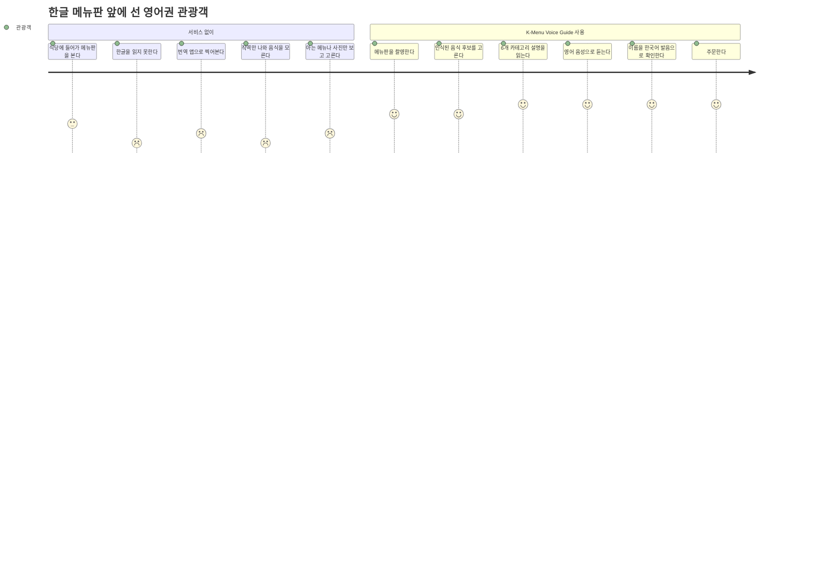
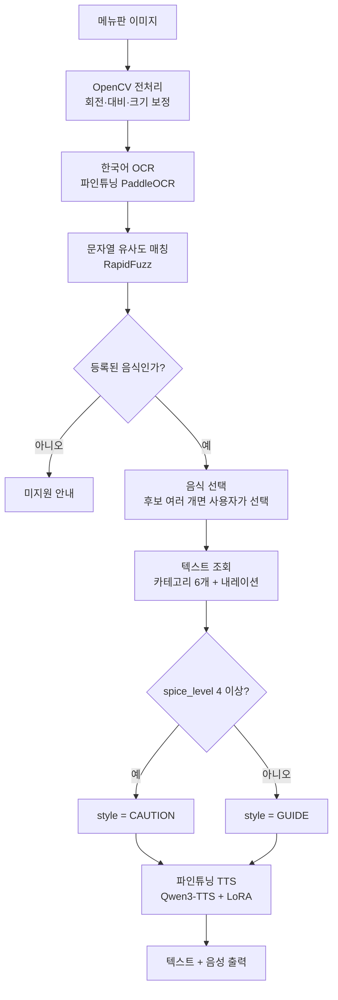
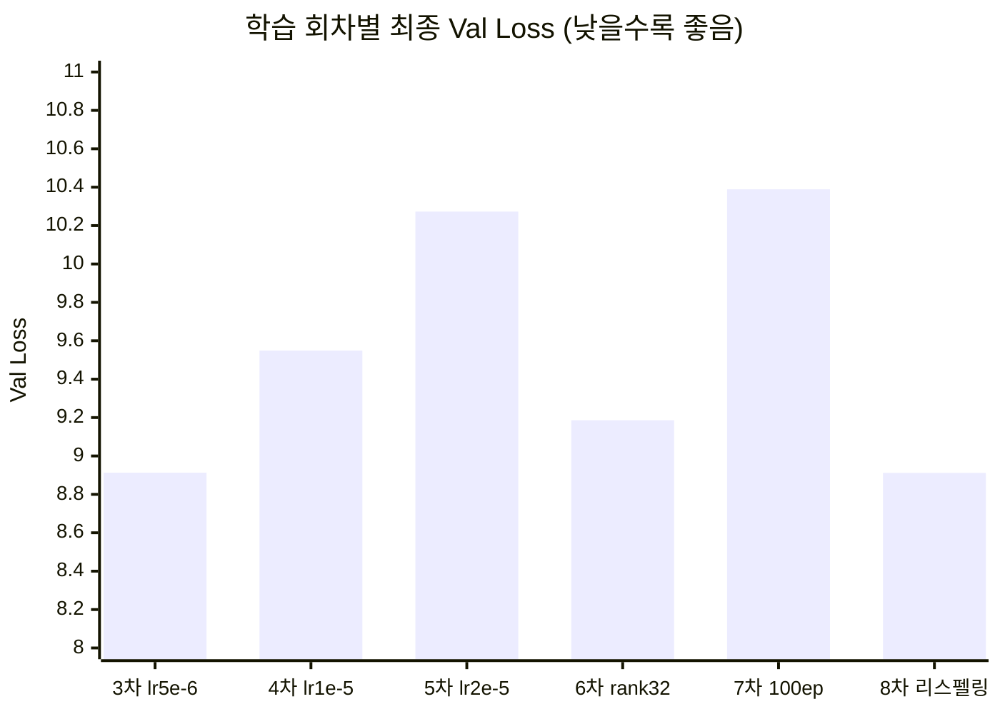
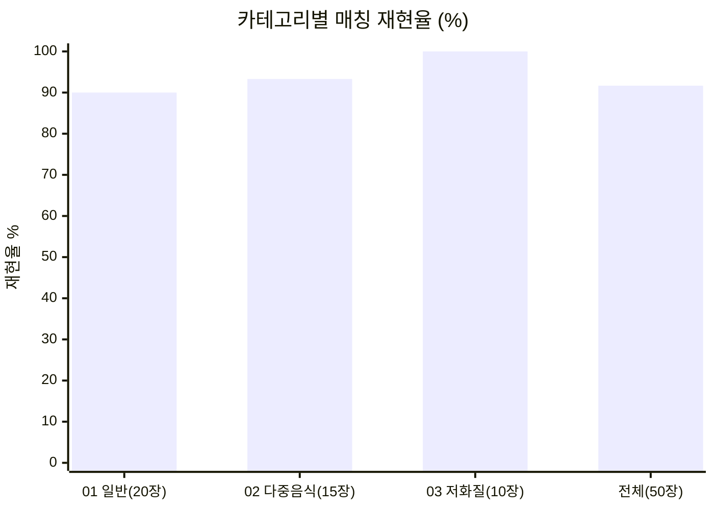
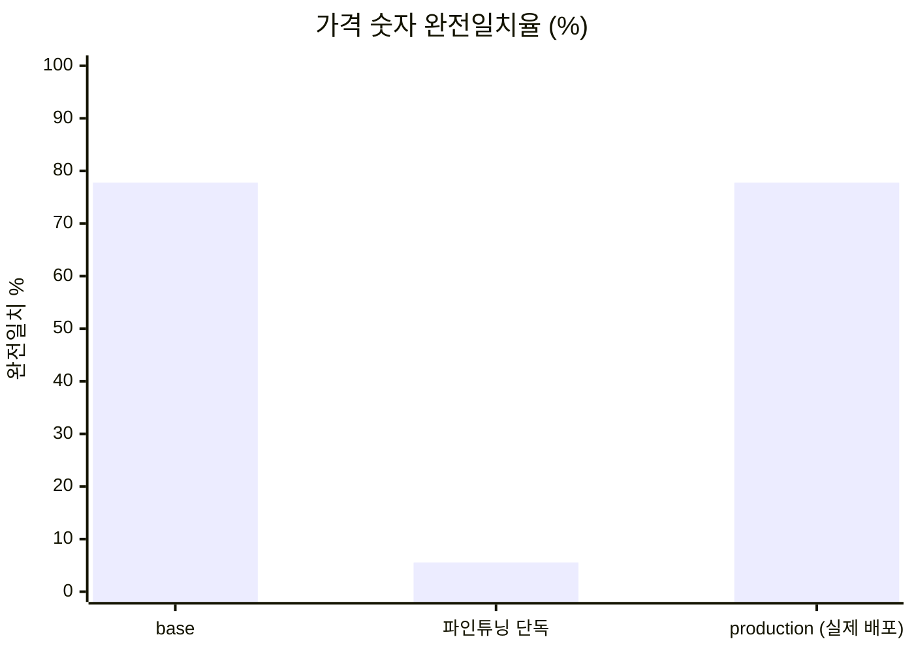
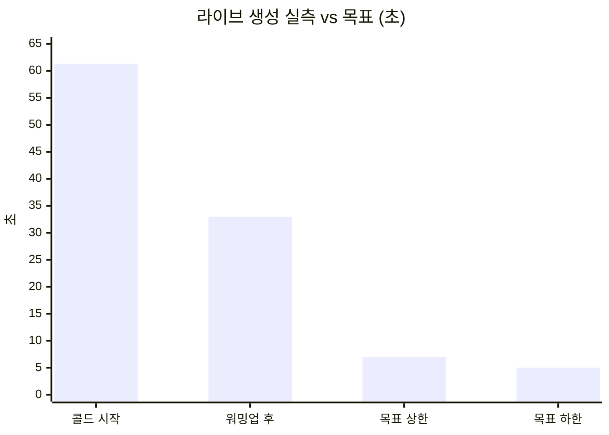
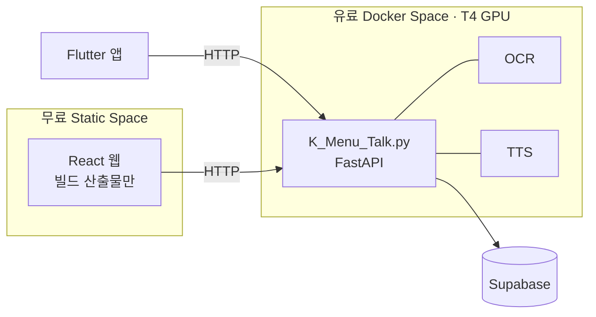
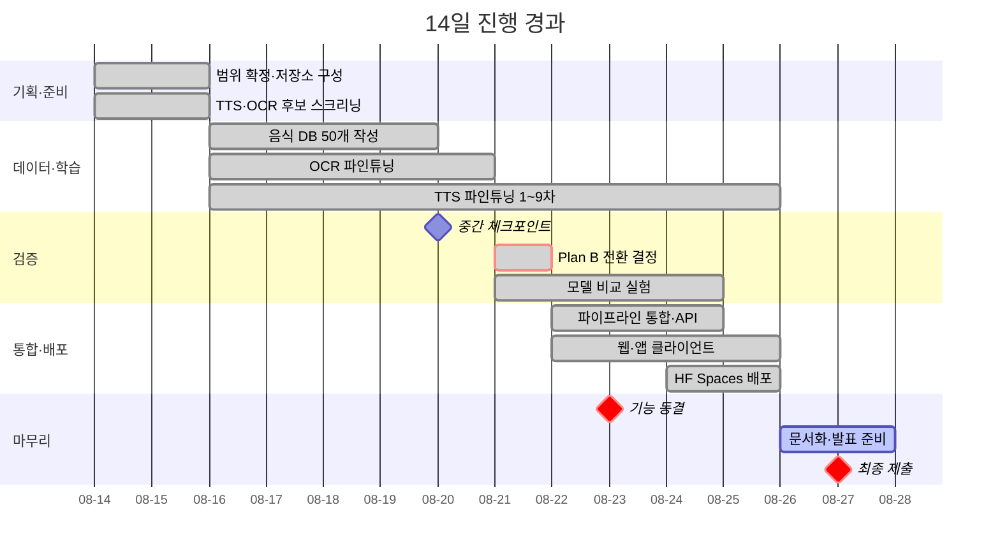

# 기획서 — K-Menu Voice Guide

> 이 문서는 **왜 만들었고 무엇을 달성했는가**를 다룬다.
> 코드 구조·실행 방법·배포 절차는 [README.md](../README.md)에 있다.
>
> 최종 갱신: 2026-08-26

| 항목 | 내용 |
|---|---|
| 프로젝트 | KDT AI Human 7기 1차 프로젝트 · 나만의 음성모델 만들기 |
| 주제 유형 | 유형 2 — 입력 조건(맵기)에 따른 조건부 TTS |
| 팀 | C조 4명 |
| 개발 기간 | 14일 (기능 동결 08-23 · 최종 제출 08-27) |
| 가용 자원 | 원격 데스크톱 RTX 3080 Ti 12GB · 노트북 RTX 5060 · Colab |

## 한 줄 소개

영어권 관광객이 한국어 메뉴판을 촬영하면, 음식의 발음·맵기·재료·먹는 법·알레르기까지
영어 텍스트와 음성으로 설명해주는 멀티모달 한국 음식 가이드.

### 역할 분담

| 이름 | 담당 |
|---|---|
| 하정운(조장) | PM · OCR 파인튜닝 · 파이프라인 통합 · DB · 배포 |
| 박민영 | TTS 파인튜닝 · 하이퍼파라미터 실험 · UX/UI |
| 배재훈 | 데이터 구축 (프로젝트 참여 종료) |
| 차백호 | TTS 추론 |

---

## 1. 문제 정의

### 대상 사용자

한국 음식에 익숙하지 않은 **영어권 개별 관광객**. 단체 가이드 없이 식당에 들어가 한글
메뉴판을 마주하는 상황이다.

### 지금 겪는 불편

번역 앱은 **글자를 옮길 뿐**이라 음식이 무엇인지는 여전히 알 수 없다.

> 곱창전골 → Beef intestine hot pot
> 번역은 됐지만 맛·조리 방식·먹는 방법·매운 정도는 알 수 없다.

### 왜 지금 풀어야 하는가

방한 외국인 관광객은 2023년 1,103만 명에서 2025년 1,893만 명으로 늘었고, 음식점 소비 중
한식 비중이 80.6%로 가장 높다(제주관광공사·신한카드 빅데이터, 2023). 여행 블로그 등
1차 자료에서도 한글 메뉴판을 읽지 못해 주문에 실패한 사례가 확인된다
([Jaclynn Seah, "My Seoul Food Experience," 2024](https://theoccasionaltraveller.com/seoul-food/)).

### 고객 여정 맵

점수가 낮을수록 사용자가 막히는 지점이다.

| 단계 | Pain Point | 서비스 개입 |
|---|---|---|
| 메뉴판 확인 | 한글을 읽지 못함 | 사진 촬영 → OCR |
| 번역 시도 | 직역으로는 음식을 모름 | 등록 음식 매칭 후 6개 카테고리 설명 |
| 후보 선택 | 어떤 게 맞는지 헷갈림 | 번호+카드 UI로 사용자가 선택 |
| 이해 | 발음을 모름 · 매운지 모름 | 한국어 발음 음성 + 맵기 5단계 아이콘 |
| 주문 | 직원에게 전달 어려움 | 장바구니 → 주문 요약 |

### 왜 번역 앱만으로는 부족한가

| 서비스 | 분류 | 한계 |
|---|---|---|
| 파파고·구글 번역 | 범용 번역 | 글자만 옮김. 재료·맵기·먹는 법 없음 |
| 캐치테이블 영어버전 | 예약 앱 | 예약이 핵심. 음식 정보 응답 기능 없음 |
| 일반 TTS 서비스 | 음성 합성 | 한국 음식명을 영어 음운으로 읽어 발음이 틀림 |

---

## 2. 해결 방식

메뉴판 사진 한 장에서 **음식 인식 → 설명 조회 → 조건부 음성 생성**까지 자동으로 잇는다.

### 세 블록의 입출력 계약

| 단계 | 모듈 | 입력 | 출력 |
|---|---|---|---|
| 1 | `src/ocr/` | 메뉴판 이미지 | 음식 후보 목록 |
| 2 | `src/text_gen/` | 선택된 음식 | 상세 텍스트 6개 + 내레이션 텍스트 1개 |
| 3 | `src/tts/` | 내레이션 텍스트 + 스타일 | WAV 음성 |

### 조건부 TTS — 주제 유형 2를 만족하는 지점

음식의 `spice_level`(1~5)이 **입력 조건**이 되어 음성 스타일을 자동으로 가른다.

| spice_level | style | 톤 |
|---|---|---|
| 1~3 | `GUIDE` | 안내하듯 차분하게 |
| 4~5 | `CAUTION` | 주의를 주듯 강조해서 |

사용자가 스타일을 고르지 않는다 — 음식 데이터가 정한다.

### 설명을 LLM으로 생성하지 않은 이유

외부 LLM API를 런타임에 쓰지 않는다. 알레르기·재료 정보에서 **환각이 나오면 안전 문제**가
되기 때문이다. 팀이 미리 작성해 Supabase에 넣어둔 문장을 조회해 조합할 뿐이다.
TTS 모델도 음식 지식을 학습하지 않고 발음·톤만 담당한다.

---

## 3. 범위

### 할 것

- 지원 언어: 영어 1개
- 지원 음식: 한국 대표 음식 **50개**
- 설명 카테고리 **6개**(발음·맵기·설명·재료·먹는 법·알레르기/채식) 자동 제공
- TTS 스타일 **2개**(GUIDE·CAUTION), `spice_level` 기준 자동 결정
- 맵기 표시: 불꽃 아이콘 5단계 + 참고 스코빌 수치
- 음식 이름만 읽어주는 별도 음성(한국어 발음 확인용)
- 장바구니 — 담기·수량·주문 요약
- 클라이언트 2종: React 웹 · Flutter 앱

### 하지 않을 것 (Out of Scope)

- 등록되지 않은 음식 설명 — **추측하지 않고 미지원으로 안내한다**
- 실시간 동영상 OCR · 손글씨 메뉴 완벽 인식
- 식당 주문·결제·예약, 직원과의 실시간 통역
- 사용자 음식 등록 기능
- 영어 이외 다국어
- 자유로운 AI 대화(외부 LLM API)
- 음성 질문 입력(STT) — 기획 초기 후보였으나 **범위에서 제외**했다

---

## 4. 성공 기준 대비 달성

| 기준 | 목표 | 실측 | 판정 | 근거 |
|---|---|---|---|---|
| OCR 음식명 매칭 정확도 | 90% 이상 | **91.67%** | 달성 | `eval/measure_ocr_final.json` |
| OCR 글자 오류율(CER) | — | 2.50% | 참고 | AI Hub 검증셋 6,500장 |
| TTS 응답 시간(TTFB) | 5~7초 | 라이브 **33초** → 캐시 **1.8ms** | 구조 전환 후 달성 | `eval/model_comparison.md` 3절 |
| TTS 품질 (Perso.ai 대비) | 85% 이상 | GUIDE **104.3%** · CAUTION **106.9%** | 달성 | `eval/TTS_MODULE.md` |
| 사람 MOS (발음 +0.4점 · 스타일 구분 85%) | AC5 | 평가자 2/5명 | **미완** | `eval/mos_scores.csv` |
| 지원 음식 수 | 50개 | 50개 | 달성 | `docs/specs/supported-foods.md` |
| 미등록 음식 오안내 | 0건 | 미지원 안내로 처리 | 달성 | `src/ocr/match.py` |

TTFB는 **라이브 생성으로는 목표를 못 맞췄고**, 구조를 바꿔서 달성했다. 경위는 6장에 있다.

---

## 5. 모델 선택 근거

### 5-1. TTS — 왜 이 하이퍼파라미터인가

LoRA 설정을 바꿔가며 6회 학습했다. **기준(lr 5e-6 · rank 16 · 40 epoch)이 최저 Val Loss였고,
세 방향으로 흔들어봤지만 전부 나빠졌다.**

| 회차 | 바꾼 것 | 최종 Val Loss | 해석 |
|---|---|---|---|
| 3차 `lr5e-6_ep40` | 기준 | **8.913** | 기준선 |
| 4차 `lr1e-5_ep40` | LR 2배 | 9.549 | 나빠짐 |
| 5차 `lr2e-5_ep40` | LR 4배 (공식 기본값) | 10.273 | 더 나빠짐 |
| 6차 `lr5e-6_r32_ep40` | LoRA rank 32 | 9.186 | 용량을 키워도 이득 없음 |
| 7차 `lr5e-6_ep100` | 100 epoch | 10.389 | 오래 돌리면 오히려 악화 |
| 8차 `final_respelled` | 리스펠링 21개 반영 | **8.912** | 기준과 동등 |

원본: `eval/training_log.csv` (에폭별 300행)

**공식 기본값(lr 2e-5)이 우리 데이터에서는 가장 나빴다**는 게 이 실험의 결론이다. 데이터가
단일 화자·소량이라 큰 학습률이 어댑터를 흔든 것으로 본다.

### 5-2. 배포 모델 구성

학습 차수와 배포 구성은 다른 층위다. 아래가 현재 배포되는 조합이다.

| 층 | 값 | 근거 |
|---|---|---|
| 베이스 모델 | `Qwen/Qwen3-TTS-12Hz-1.7B-Base` | `src/tts/infer.py` |
| 어댑터 | `k-bite-team/k-menu-qwen3-tts-lora` | 〃 |
| 체크포인트 | **9차** `instruct_trained_lr5e-6_ep40` / `checkpoint-epoch-31` (Val 8.8919) | `eval/TTS_MODULE.md` 3절 |
| `LORA_SCALE` | **0.15** (0.3에서 낮춤) | `src/tts/infer.py:74` |
| TTS 입력 표기 | **한글**(`name_kr`) 치환 | `src/text_gen/narration.py` |
| 발음 안내 문장 | `PRONUNCIATION_TTS` 전용 행 | `docs/specs/tts-finetuning.md` |

9차는 8차와 하이퍼파라미터가 같고, **`instruct`(톤 지시)를 추론뿐 아니라 학습에도 반영하도록
학습 스크립트를 고쳐 재학습**한 것이다. 8차까지는 instruct가 추론 시점에만 걸려 학습 조건과
추론 조건이 어긋나 있었다.

> ⚠️ 9차 학습 로그는 저장소에 없다. `eval/training_log.csv`는 3~8차만, 노트북도 8차 기준이다.
> 재현하려면 학습 스크립트 수정본이 필요하다.

### 5-3. OCR — 난이도별 성능

테스트셋 `OCR_test_set_50`(실제 메뉴판 사진 50장)을 난이도별로 나눠 측정했다.

| 카테고리 | 장수 | 라벨 완전일치 | CER | 매칭 재현율 |
|---|---|---|---|---|
| 01_normal | 20 | 54.2% | 29.5% | 90.0% |
| 02_multi_food | 15 | 78.5% | 26.6% | 93.3% |
| 03_low_quality | 10 | 63.2% | 35.5% | 100.0%* |
| 04_unregistered | 5 | 16.7% | 47.7% | — (매칭 대상 없음) |
| **전체** | **50** | **66.7%** | **29.2%** | **91.67%** |

\* 저화질 10장 중 매칭 대상이 1장뿐이라 표본이 작다.

**라벨 완전일치(66.7%)보다 매칭 재현율(91.67%)이 훨씬 높은 것**이 이 설계의 핵심이다.
OCR이 글자를 조금 틀려도 RapidFuzz 유사도 매칭이 등록 음식 50개 중 정답을 찾아낸다.
OCR 단독 성능이 아니라 **OCR + 매칭의 합**을 목표로 잡았기 때문에 90% 기준을 넘겼다.

### 5-4. 파인튜닝의 대가 — 숫자 인식 붕괴와 하이브리드 대응

음식명은 좋아졌지만 **가격 숫자를 읽는 능력을 잃었다.**

| 인식기 | 숫자 완전일치 | 숫자 CER | 금액 복원 |
|---|---|---|---|
| base (PaddleOCR 기본) | 77.78% | 3.44% | 100% |
| 파인튜닝 체크포인트 | **5.56%** | **37.18%** | 41.67% |
| **production (실제 배포 경로)** | **77.78%** | **3.44%** | **100%** |

- **원인**: catastrophic forgetting. 등록 음식 50개에 쓰인 글자만 모은 커스텀 딕셔너리로
  학습해서, 라벨에 없던 숫자·통화기호를 읽는 능력이 사라졌다.
  실패 형태가 그대로 드러난다 — `9,000` → `C0`, `12,000` → `12.00`, `₩7,000` → `000`
- **대응**: `src/ocr/infer.py`의 `_better_reading()`이 **한글이 없는 조각은 base 결과를 채택**한다.
  두 인식기를 조각 단위로 갈아끼우는 하이브리드다.
- **결과**: 배포 경로 수치가 base와 같다 — 파인튜닝의 손실이 사용자에게 도달하지 않는다.

측정: `python eval/measure_digits.py` (GPU·외부 테스트셋 없이 재현 가능)

### 5-5. 상용 서비스와의 비교 — Perso.ai

같은 화자 클로닝·같은 문장으로 생성해 UTMOS22로 채점했다.

| 스타일 | 우리 모델 | Perso.ai | 상대 점수 |
|---|---|---|---|
| GUIDE | 4.29 | 4.11 | **104.3%** |
| CAUTION | 4.44 | 4.16 | **106.9%** |

성공 기준(85% 이상)을 넘겼고, 두 스타일 모두 **상용 서비스보다 높게 채점됐다.**
원본 오디오: `eval/perso_comparison/`

비교에 쓴 모델은 **현재 배포와 같은 9차 `epoch-31`**이고, Perso.ai 쪽은 같은 화자를
클로닝(`voice_id: psv-5fb5...`)해 조건을 맞췄다. 화자 본인 동의 문서는
[`docs/legal/tts-voice-consent/`](legal/tts-voice-consent/)에 있다.

> ⚠️ **"이겼다"고 단정하지 않는다.** 표본이 스타일당 1문장(n=1)이라 통계적 유의성이 없다.
> 또한 채점에 쓴 문장이 로마자 리스펠링 표기(`Duck-bok-kee`)라, 한글 표기로 전환한
> 현재 배포 입력과는 다르다. 76문장 규모의 확대 재평가가 남아 있다.

---

## 6. 엔지니어링 판단 3건

기획대로 되지 않아 **측정하고 구조를 바꾼** 지점들이다.

### 6-1. 실시간 생성 포기 → 사전 생성 캐싱 (2026-08-21)

사전 생성 캐시는 **1.8ms**라 위 그래프에 그릴 수 없다 — 목표 하한 5초의 약 **1/2,800**이라
막대 높이가 0이 된다. 축을 나눠야 보이는 차이라는 것 자체가 전환의 근거다.

| 항목 | 값 |
|---|---|
| TTFB 목표 (D5 팀 합의) | 5~7초 |
| 라이브 생성 실측 | 워밍업 후 33초 (콜드 61.3초) |
| RTF (실시간 계수) | 평균 **1.47** — 1.0 초과는 실시간 생성 불가를 뜻한다 |
| 사전 생성 캐시 실측 | **평균 1.8ms** (n=50) |

RTF 1.47은 *"10초짜리 음성을 만드는 데 14.7초가 걸린다"*는 뜻이다. 하드웨어를 바꾸는
수준으로는 5초 목표에 닿을 수 없다고 판단해, **등록 음식 50개 × 스타일을 미리 생성해
캐시에 넣는 방식으로 전환**했다. 음식이 50개로 고정돼 있어서 가능한 선택이다.

> **병목은 TTS가 아니라 DB 첫 로드였다.** 캐시 히트 자체는 파일 복사(1.7ms)뿐이고,
> 사용자가 체감하는 콜드 비용 2,527ms는 서버 기동 후 첫 요청에서 Supabase 4개 테이블을
> 읽는 왕복이다. 두 번째 요청부터는 메모리 캐시라 사라진다.

### 6-2. 한글 발음 문제 — 재학습 없이 입력으로 해결 (2026-08-25)

모델이 `Tteokbokki`를 영어 음운으로 읽어 발음이 틀렸다.

| 시도 | 방법 | 결과 |
|---|---|---|
| 1차 | 영문 리스펠링 (`Tteokbokki` → `Duck-bok-kee`) 21개 수작업 | **실패** — 리스펠링한 21개뿐 아니라 원본 표기가 적절하다고 판정했던 29개까지 부정확 |
| 2차 | TTS 입력에서만 음식명을 **한글 표기로 치환** | **성공** — 50개 전부 한 번에 해결 |

**원인이 철자가 아니라 읽는 음운 체계였다.** 로마자로 적혀 있는 한 모델은 영어 음운으로
읽으므로, 철자를 아무리 손봐도 해결되지 않는다. 한글로 적으면 베이스 모델의 한국어 능력이
작동한다.

- 구현은 `narration.py`의 정규식 치환 한 줄이다. **재학습도 사전 테이블도 필요 없었다.**
- 화면에는 로마자를 그대로 남긴다 — 여행자가 소리 내어 읽어야 하는 정보이기 때문이다.
- 이름을 두 번 읽는 부작용(`비빔밥 is pronounced "bee-bim-bap."`)은 음성 전용
  `PRONUNCIATION_TTS` 행을 DB에 따로 두어 막았다.

### 6-3. GPU를 어디에 둘 것인가 — Space 2분할

| 측정 | CPU | GPU |
|---|---|---|
| OCR 92상자 처리 (2026-08-23, RTX 3080 Ti) | 22.8초 | **0.8초** |

계산은 GPU에 있어야 한다는 게 숫자로 굳었다. 다만 **GPU Space는 유료**라, 화면까지 같은
Space에 두면 비용이 두 배가 된다. 그래서 둘로 나눴다.

- ZeroGPU를 쓸 수 없었다 — **PyTorch 전용 메커니즘이라 PaddleOCR이 GPU를 못 쓴다**(조사 2026-08-21).
  그래서 전용 T4를 붙였다.
- 웹과 앱은 같은 HTTP 계약(`docs/specs/api-layer.md`)을 쓰는 **대등한 두 클라이언트**다.
  한쪽이 다른 쪽을 대체하지 않는다.

---

## 7. 일정

---

## 8. 주요 위험과 대응

| 위험 | 결과 | 대응 |
|---|---|---|
| TTS 응답 지연이 목표 초과 | **현실화됨** | 사전 생성 캐싱으로 전환 (6-1) |
| 파인튜닝으로 숫자 인식 붕괴 | **현실화됨** | base/파인튜닝 하이브리드 채택 (5-4) |
| 한국 음식명 발음 부정확 | **현실화됨** | 한글 표기 치환 (6-2) |
| ZeroGPU에서 PaddleOCR 불가 | **현실화됨** | 전용 T4 Space로 전환 (6-3) |
| OCR·TTS 동시 학습으로 GPU 경합 | 관리됨 | TTS는 Colab, OCR은 로컬 GPU로 분산 |
| Supabase 무료 티어 7일 비활동 정지 | 관리됨 | 서버 메모리 캐싱으로 의존도 최소화 |
| 알레르기 정보 오인 | 상시 | 참고용임을 화면에 명시. 외부 LLM 미사용으로 환각 차단 |
| 팀원 1명 참여 종료 | 발생 | 데이터 구축 업무를 조장이 흡수 |

---

## 9. 한계와 남은 과제

정직하게 적는다. **측정하지 않은 것을 달성했다고 쓰지 않는다.**

| 항목 | 상태 | 필요한 것 |
|---|---|---|
| 사람 MOS 정식 평가 | 평가자 2/5명 | 외부 평가자 5명 블라인드 A/B (ITU-T P.800) |
| 현재 배포 설정의 UTMOS | **미측정** | scale 0.15 · 한글 표기 기준 재측정 (GPU 필요) |
| base PaddleOCR 비교 수치 | **미측정** | 테스트셋 원본이 있는 PC에서 `measure_ocr.py --rec paddle-base` |
| 9차 학습 로그 | **미보존** | `training_log.csv`·노트북이 8차 기준 |
| Perso.ai 비교 표본 | n=1 | 76문장으로 확대 재평가 |
| 배포 환경 레이턴시 | 로컬 실측만 | HF Spaces 실측 (컨테이너 디스크·Supabase 왕복 반영) |
| 저화질 OCR 표본 | 매칭 대상 1장 | 테스트셋 보강 |

### 다음 단계 (MVP 이후)

- 다국어 확대 (중국어·일본어)
- 지원 음식 카테고리 확장
- 사용성 테스트 (외부 피드백)
- 아바타 영상 등 멀티모달 확장

---

## 참고 문서

| 문서 | 내용 |
|---|---|
| [README.md](../README.md) | 코드 구조·실행·배포 |
| [eval/model_comparison.md](../eval/model_comparison.md) | 모델 비교 실험 원본 |
| [eval/TTS_MODULE.md](../eval/TTS_MODULE.md) | TTS 파인튜닝 전 회차 기록 |
| [docs/specs/](specs/) | 기능별 Spec (Why·Goal·What·How·AC) |
| [AGENTS.md](../AGENTS.md) | AI 에이전트 작업 지침 |
